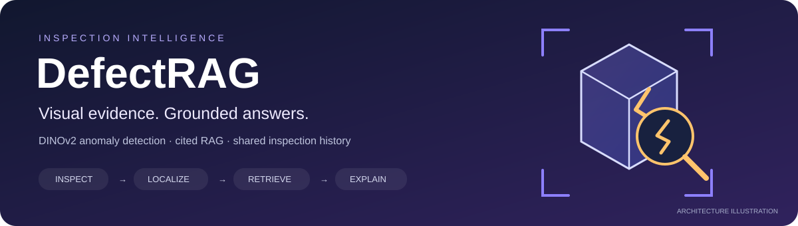
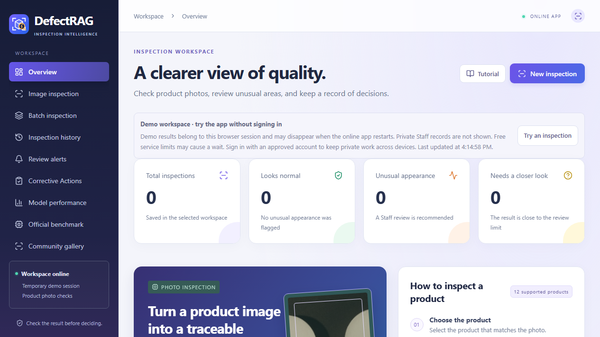
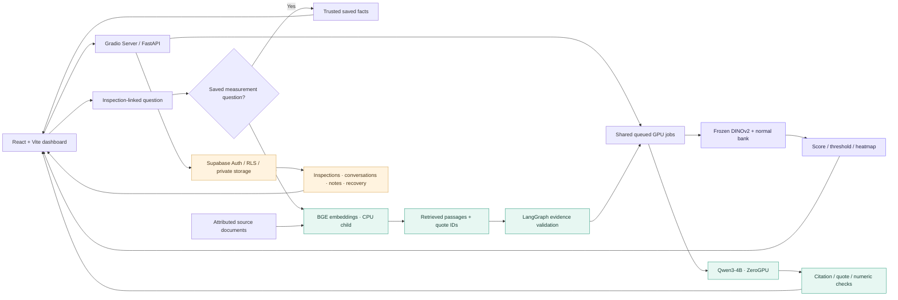

<div align="center">
  

  <p><strong>Industrial visual anomaly inspection with retrieval-augmented generation.</strong></p>
  <p>Real image measurements, coarse heatmaps, cited explanations and shared review history.</p>

  <a href="https://huggingface.co/spaces/Wizzas/DefectRAG"></a>
  
  
  
  <br/>
  
  
  
  
  
  

  <p><a href="https://huggingface.co/spaces/Wizzas/DefectRAG">Live application</a> · <a href="#architecture">Architecture</a> · <a href="#measured-results">Results</a> · <a href="#quick-start">Quick start</a> · <a href="docs/PUBLIC_APPLICATION_GUIDE.md">Application guide</a></p>
</div>

## Overview

DefectRAG combines frozen visual encoders with a normal-reference memory bank and
an inspection-linked RAG assistant. The existing React dashboard supports image
inspection, visual comparison, batch history, evaluation, reports, staff notes,
review alerts and recoverable archival. One Gradio Server-mode Hugging Face Space
hosts the cloud UI, CPU services and queued ZeroGPU inference.

| Visual inspection | Evidence-grounded RAG | Shared review |
|---|---|---|
| Frozen DINOv2 features across 12 VisA products | BGE retrieval over attributed documents | Supabase authentication and existing RLS |
| Nearest-normal anomaly scores and calibrated thresholds | LangGraph routing, Qwen generation and citation checks | Private images, heatmaps, conversations and notes |
| Interpolated patch-distance heatmaps | Saved measurements remain separate from document claims | Acknowledgments, CSV, printable reports and developer recovery |

> **Operating scope:** benchmark appearance screening. Scores are distances, not
> defect probabilities. The product category is operator-selected; the system
> does not diagnose defect types, causes, manufacturing tolerances or repairs.

<details>
<summary><strong>Dashboard preview</strong></summary>
<p></p>
</details>

## Architecture



**RAG is retrieval-augmented generation.** LangChain loads/chunks documents and
retrieves BGE vectors; LangGraph coordinates scope checks, retrieval, generation
and answer validation. Qwen generates explanations from retrieved evidence.
Direct score/verdict answers use saved measurements without pretending to call an
LLM. The assistant receives inspection facts and conversation, not image pixels.

| Component | Cloud deployment | Preserved local application |
|---|---|---|
| UI | Existing React/Vite dashboard | Same dashboard |
| Host | Gradio 6.30 Server mode + FastAPI | FastAPI / Uvicorn |
| Active visual model | Frozen DINOv2 ViT-S/14, 448px short edge | DINOv2 high-resolution; original DINOv3 retained |
| Retrieval | BGE-small-en-v1.5 in a CPU-only subprocess | Existing local BGE embeddings/index |
| Generation | Qwen3-4B-Instruct-2507 on ZeroGPU | Ollama qwen2.5:3b |
| Persistence | Supabase for approved staff; isolated temporary guest history | SQLite and local artifacts; optional staff sharing |
| Transformers | 5.20.1, isolated cloud environment | 4.57.6 production requirements |

Package badges describe the validated cloud/frontend versions. Local and cloud
environments intentionally differ. No fine-tuning or epoch-based training is used:
normal images populate memory banks while encoder weights remain frozen.

## Measured results

Retrospective development comparison on the official VisA train/test assignments:
**12 products, 8,659 training normals, 2,162 test images, seeds 42/43/44**.
Earlier test results informed development; this is not an untouched external test
or a reproduction of a published method.

| Macro mean over 12 products | Original DINOv3 | DINOv2 high resolution |
|---|---:|---:|
| **Image AUROC** | **85.38%** | **95.13%** |
| Image AU-PR | 86.47% | 95.74% |
| Pixel AUROC | 92.96% | 98.60% |
| Pixel AU-PR | 33.29% | 43.04% |
| Supplementary image AP | 86.58% | 95.77% |

The deployment bank has a separate normal-only calibration holdout. Its
recall-oriented `normal-q95-v1` policy uses the fixed 95th percentile of normal
calibration scores, with no weight updates. The original policy remains available.

| Retrospective operating metrics | Original maximum-normal | Normal q95 |
|---|---:|---:|
| Macro recall | 60.17% | **83.83%** |
| Macro precision | **97.59%** | 93.26% |
| Macro F1 | 68.63% | **87.56%** |
| Macro normal false-alarm rate | **2.42%** | 7.43% |

Higher sensitivity produces more false alarms. Policy selection followed the
observed recall problem; these are development results, not independent validation
or guaranteed future performance. AUROC is unchanged by threshold calibration.
Macaroni1/2 recall remains limited at 57%/48%. Historical inspections retain their
original decisions. [Calibration details and rollback](docs/SENSITIVITY_CALIBRATION.md).

Ground-truth masks are used for pixel evaluation only. The PCA foreground rule
is a heuristic, and interpolated heatmaps are not supervised segmentation. The
headline is mean image AUROC, with AU-PR and operating recall alongside it; this
is not YOLO bounding-box mAP@IoU.

[Full comparison](docs/ACCURACY_RESULTS.md) · [Metric definitions](docs/ACCURACY_AND_METRICS.md) · [Recall and answer-quality notes](docs/RECALL_AND_RESPONSE_QUALITY.md)

## Quick start

### Public application

Open **[Wizzas/DefectRAG](https://huggingface.co/spaces/Wizzas/DefectRAG)**.
HF sign-in supplies available GPU quota; Supabase staff sign-in separately
authorizes persistent shared records. Embedded and direct app links can have
separate browser sessions. Free quotas, cold starts and queue waits apply.

### Existing Windows installation

```powershell
cd C:\Users\User\Desktop\DefectRAG-v2
.\Start-DefectRAG.cmd -Port 8767
```

Open http://127.0.0.1:8767. Existing models and evaluation results are reused;
no fitting or download is needed. For local generated explanations, Ollama must
be running with `qwen2.5:3b` installed.

### Fresh source clone

The GitHub source export excludes model weights, reference banks, private records
and environments. Node.js/npm and Python 3.11 are required for this setup:

```powershell
git clone <repository-url>
cd DefectRAG
py -3.11 -m venv .venv
.\.venv\Scripts\python.exe -m pip install -r requirements.txt
.\.venv\Scripts\python.exe -m scripts.fetch_public_assets --list
# Optional explicit download of pinned public model/sample/evaluation assets:
.\.venv\Scripts\python.exe -m scripts.fetch_public_assets
.\Start-DefectRAG.cmd -Port 8767
```

The launcher builds missing frontend assets using `npm ci`. The asset downloader
fetches the immutable published DINOv2 profile and verifies bank checksums; it
does not retrain models. This fresh-clone recipe is documented but was not
validated by another full dependency/model download. CPU inference is supported;
NVIDIA acceleration requires compatible CUDA PyTorch wheels. Legacy DINOv3 assets
are preserved in existing installations and are not included in that DINOv2 download.

### Development checks

```powershell
python -m pytest tests -q
node tests/test_space_batch.mjs
npm.cmd test --prefix frontend
npm.cmd run build --prefix frontend
```

Cloud migration builds separately under `development-support/space/ui-dist`.
Deployment instructions: [Space adapter](deployment/space/README.md).
Supabase SQL changes require review; no public service-role key belongs in config.

## Validation and limits

- Real local/cloud inspection parity across all 12 products; maximum observed
  score difference 0.00053 in the saved 24-image integration comparison.
- Genuine Qwen generation, cited document answers and saved measurement answers.
- Approved developer RPC success, anonymous denial, notes, acknowledgment,
  reports/CSV/private images and reversible recovery verified.
- Staff records and conversations survived an actual Space deployment restart.
- Authenticated non-staff/ordinary-staff role matrices, distinct-user collaboration,
  successful combined multi-file submission and sustained load remain unverified.
- Staff-submitted answers lack model-provenance attestation; acknowledgments lack
  actor/time audit. These hardening limits remain documented, not silently changed.

[Deployment evidence](docs/ZEROGPU_PHASE5_RESULTS.md) · [Staff integration results](docs/ZEROGPU_PHASE4_RESULTS.md)

## Repository map

```text
backend/              Visual scoring, RAG workflow, API and SQLite persistence
frontend/             React dashboard, SVG brand assets and public showcase
knowledge/            Attributed RAG documents and source metadata
deployment/space/     Gradio adapter, queued inference and Supabase repository
scripts/              Explicit asset setup, evaluation and source export tools
tests/                API, answer relevance, protocol and security checks
docs/                 Architecture, measured results, guides and evidence
results/              Selected public benchmark and deployment summaries
```

Upload source and public documentation, not the whole working application folder.
[GitHub upload guide and description](docs/GITHUB_PUBLISHING.md) explains the
prepared source-only export, exclusions and safe configuration template.

## References and licensing

- [VisA / SPot-the-Difference](https://github.com/amazon-science/spot-diff), Zou et al., ECCV 2022 — CC BY 4.0 dataset.
- [DINOv2](https://github.com/facebookresearch/dinov2) — frozen visual encoder; Apache-2.0.
- [AnomalyDINO](https://github.com/dammsi/AnomalyDINO) — inspiration for the custom high-resolution adaptation; no reproduction claim.
- [BGE-small-en-v1.5](https://huggingface.co/BAAI/bge-small-en-v1.5) — retrieval embeddings.
- [Qwen3-4B-Instruct-2507](https://huggingface.co/Qwen/Qwen3-4B-Instruct-2507) — cloud text generation.

Application code: [MIT](LICENSE). Model/dataset licenses are separate.
[Third-party notices](docs/THIRD_PARTY_NOTICES.md) preserve attribution. Included
application screening guidance describes software scope; it is not an approved
factory standard operating procedure or acceptance specification.
