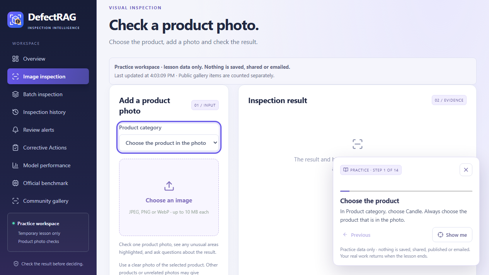
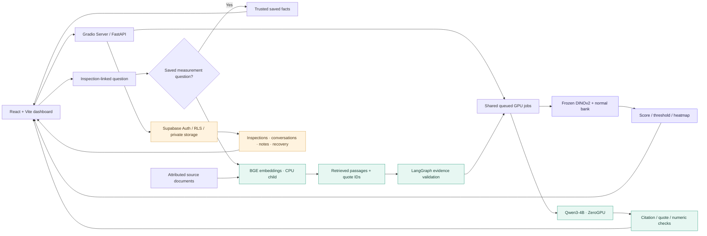
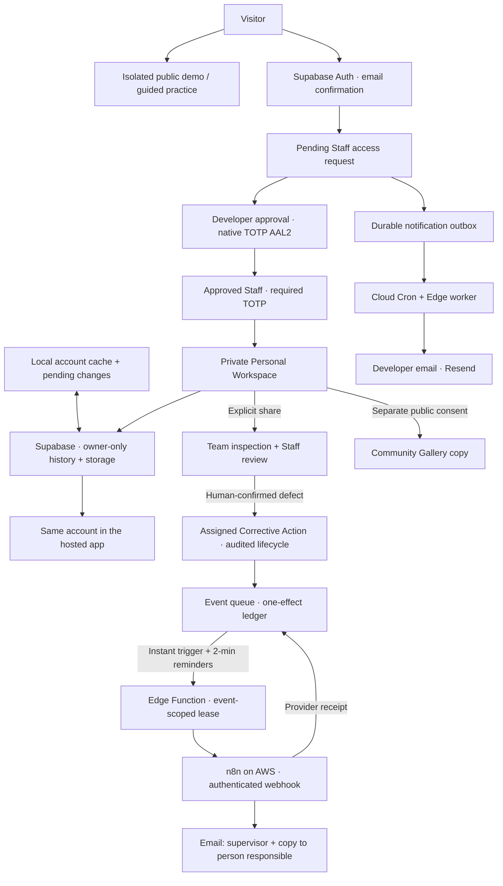
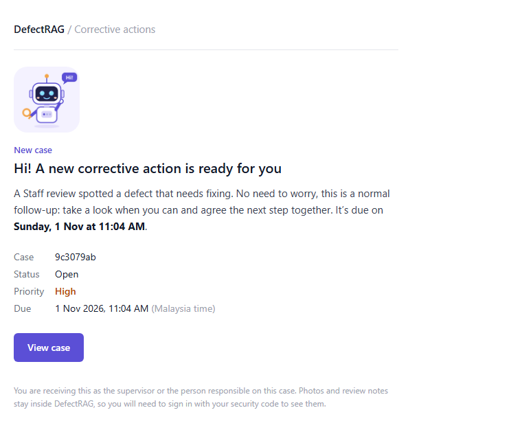

<div align="center">
  

  <p><strong>Industrial visual anomaly inspection with retrieval-augmented generation.</strong></p>
  <p>Visual evidence, cited explanations, private synchronized workspaces and accountable team review.</p>

  <a href="https://huggingface.co/spaces/Wizzas/DefectRAG"></a>
  
  
  
  <br/>
  
  
  
  
  
  
  
  

  <p><a href="https://huggingface.co/spaces/Wizzas/DefectRAG">Live application</a> · <a href="#current-capabilities">Features</a> · <a href="#architecture">Architecture</a> · <a href="#measured-results">Results</a> · <a href="#quick-start">Quick start</a> · <a href="docs/STAFF_QUICK_GUIDE.md">Staff guide</a></p>
</div>

## Overview

**Run locally:** use the [setup guide](docs/SETUP.md) for the synchronized
dashboard. Developer registration emails use the independent Supabase/Resend
service. Corrective Action emails are live: a self-hosted n8n instance on AWS
Lightsail emails the case supervisor and copies the person responsible within
seconds of a saved change. Multimodal RAG remains future work.

DefectRAG combines frozen visual encoders with a normal-reference memory bank and
an inspection-linked RAG assistant. The existing React dashboard supports image
inspection, visual comparison, batch history, evaluation, reports, staff notes,
review alerts and recoverable archival. One Gradio Server-mode Hugging Face Space
hosts the cloud UI, CPU services and queued ZeroGPU inference.

| Visual inspection | Evidence-grounded RAG | Shared review |
|---|---|---|
| Frozen DINOv2 features across 12 VisA products | BGE retrieval over attributed documents | Supabase authentication and existing RLS |
| Nearest-normal anomaly scores and calibrated thresholds | LangGraph routing, Qwen generation and citation checks | Private images, heatmaps, conversations and notes |
| Interpolated patch-distance heatmaps | Saved measurements remain separate from document claims | Acknowledgments, CSV, printable reports and developer recovery |

> **Operating scope:** benchmark appearance screening. Scores are distances, not
> defect probabilities. The product category is operator-selected; the system
> does not diagnose defect types, causes, manufacturing tolerances or repairs.

<details>
<summary><strong>Dashboard preview</strong></summary>
<p></p>
</details>

## Current capabilities

| Capability | What it does | Status |
|---|---|---|
| **Guided practice** | A coach card walks through 14 steps on the real screens, highlighting the actual control and advancing only when the action is done, with hints for wrong choices. Practice data stays in memory and makes no network request. | Live on Hugging Face |
| **Public Demo Mode** | Visitors can explore inspection without becoming Staff. Private account and Team records remain separate. | Available; free inference quotas apply |
| **Staff registration and approval** | Email-confirmed applicants submit Pending requests. Developers approve, reject or revoke access from the interface; signup grants no Staff membership. | Implemented and activated on the existing installation |
| **Native TOTP MFA** | Approved Staff and Developers verify an authenticator code. Backend, database functions, RLS and protected storage enforce the required assurance. | Enforced on the existing installation |
| **Personal local ↔ cloud synchronization** | The same approved account uses private history across local and hosted clients, including images, heatmaps, conversations and review state. Queued changes, duplicates and conflicts have explicit handling. | Real Supabase QA verified; unsynchronized local changes are not yet cloud-saved |
| **Explicit Team collaboration** | Share a separate inspection copy, open evidence and save structured Staff reviews. Personal records are never automatically published to Team. | Implemented |
| **Corrective Actions** | The inspection picker shows each review's status and the next step. A case is created from a human-confirmed Team defect with a person responsible, supervisor and due date (Tomorrow / 3 days / 1 week / 2 weeks shortcuts). Refresh preserves drafts; concurrent updates require explicit review. Only the owner, supervisor or a Developer can edit existing cases. | Live |
| **Community Gallery** | Publish a separate public copy with explicit consent. Private notes, conversations and account history stay separate. | Hosted gallery available; local publishing needs separate configuration |
| **Developer request emails** | A durable outbox, cloud scheduler, Supabase Edge worker and Resend notify the Developer independently of the Windows laptop. | Controlled cloud delivery verified; current restricted sender is for the verified Developer recipient |
| **Corrective Action emails (n8n)** | A database trigger dispatches each new case or saved update immediately; a 2-minute schedule sends due-soon and overdue reminders and retries. A Supabase Edge Function gives n8n a short-lived, event-scoped lease; n8n emails the supervisor, copies a distinct verified person responsible and records the provider receipt. A one-effect ledger prevents duplicate sends. | Live; paused with one database flag |
| **Model results and recovery** | DINOv2/DINOv3 comparisons, all 12 categories, reports, CSV exports, review alerts and recoverable archival remain accessible. | Existing functionality preserved |

These statuses describe the verified installation on **31 October 2026**. A fresh
clone starts with blank public Supabase configuration and still needs its own
reviewed database/authentication setup; cloning does not activate cloud services.

### Learn by doing

Open **Overview → Tutorial → Start guided practice**. A coach card guides you
through the same screens used for real work: choose a product and photo, inspect,
compare images, ask the assistant, share with the team, publish with consent,
save a Staff review, create and progress a case, run a small batch and acknowledge
an alert. Each step highlights the real control and completes only when the action
is done; wrong choices get a hint.

During practice the app switches to an in-memory lesson workspace with an
attributed public example and fictional colleagues. Nothing is saved, shared,
published or emailed, no account access changes and no GPU allowance is used.
The prepared teaching answer is labelled and is not a live Qwen response.
Real work returns when the lesson ends.

<p align="center"></p>

[Staff quick guide](docs/STAFF_QUICK_GUIDE.md)

## Architecture



**RAG is retrieval-augmented generation.** LangChain loads/chunks documents and
retrieves BGE vectors; LangGraph coordinates scope checks, retrieval, generation
and answer validation. Qwen generates explanations from retrieved evidence.
Direct score/verdict answers use saved measurements without pretending to call an
LLM. The assistant receives inspection facts and conversation, not image pixels.
This is **vision-assisted text RAG**, not Multimodal RAG. Multimodal retrieval,
vision-language reasoning and model fine-tuning remain separate future work.

### Workspace, approval and automation flow



Registration, MFA assurance, case ownership and revocation are enforced below the
frontend. n8n does not generate OTPs or grant permissions and never holds a
database service key. Saving a case does not depend on email: if n8n or the mail
provider is unavailable the case stays saved and the event waits in the queue; an
ambiguous send is held for manual review instead of being repeated.

| Component | Cloud deployment | Preserved local application |
|---|---|---|
| UI | Existing React/Vite dashboard | Same dashboard |
| Host | Gradio 6.30 Server mode + FastAPI | FastAPI / Uvicorn |
| Active visual model | Frozen DINOv2 ViT-S/14, 448px short edge | DINOv2 high-resolution; original DINOv3 retained |
| Retrieval | BGE-small-en-v1.5 in a CPU-only subprocess | Existing local BGE embeddings/index |
| Generation | Qwen3-4B-Instruct-2507 on ZeroGPU | Ollama qwen2.5:3b |
| Persistence | Private Personal / explicitly shared Team records in Supabase; isolated temporary guest history | Owner-scoped local cache/outbox and private Supabase synchronization; explicit Team sharing |
| Transformers | 5.20.1, isolated cloud environment | 4.57.6 production requirements |

Package badges describe the validated cloud/frontend versions. Local and cloud
environments intentionally differ. No fine-tuning or epoch-based training is used:
normal images populate memory banks while encoder weights remain frozen.

## Measured results

Retrospective development comparison on the official VisA train/test assignments:
**12 products, 8,659 training normals, 2,162 test images, seeds 42/43/44**.
Earlier test results informed development; this is not an untouched external test
or a reproduction of a published method.

| Macro mean over 12 products | Original DINOv3 | DINOv2 high resolution |
|---|---:|---:|
| **Image AUROC** | **85.38%** | **95.13%** |
| Image AU-PR | 86.47% | 95.74% |
| Pixel AUROC | 92.96% | 98.60% |
| Pixel AU-PR | 33.29% | 43.04% |
| Supplementary image AP | 86.58% | 95.77% |

The deployment bank has a separate normal-only calibration holdout. Its
recall-oriented policy uses the fixed 80th percentile of normal calibration scores
for Macaroni1/2 and the 95th percentile for the other ten products, with no weight
updates. Both earlier policies remain available.

| Retrospective operating metrics | Original maximum-normal | All-product q95 | Targeted Macaroni q80 |
|---|---:|---:|---:|
| Macro recall | 60.17% | 83.83% | **88.83%** |
| Macro precision | **97.59%** | 93.26% | 90.47% |
| Macro F1 | 68.63% | 87.56% | **89.57%** |
| Macro normal false-alarm rate | **2.42%** | 7.43% | 11.10% |

Higher sensitivity produces more false alarms. Policy selection followed the
observed recall problem; these are development results, not independent validation
or guaranteed future performance. AUROC is unchanged by threshold calibration.
Macaroni1/2 recall is now85%/80%, with substantial normal false-alarm rates of
24%/28%; review workload is higher. Historical inspections retain their original
decisions. [Targeted policy and rollback](docs/MACARONI_RECALL_UPDATE.md) ·
[Earlier calibration](docs/SENSITIVITY_CALIBRATION.md).

Ground-truth masks are used for pixel evaluation only. The PCA foreground rule
is a heuristic, and interpolated heatmaps are not supervised segmentation. The
headline is mean image AUROC, with AU-PR and operating recall alongside it; this
is not YOLO bounding-box mAP@IoU.

[Full comparison](docs/ACCURACY_RESULTS.md) · [Metric definitions](docs/ACCURACY_AND_METRICS.md) · [Evidence Assistant architecture](docs/ARCHITECTURE.md#evidence-assistant)

## Quick start

### Public application

Open **[Wizzas/DefectRAG](https://huggingface.co/spaces/Wizzas/DefectRAG)**.
HF sign-in supplies available GPU quota; Supabase staff sign-in separately
authorizes persistent shared records. Embedded and direct app links can have
separate browser sessions. Free quotas, cold starts and queue waits apply.
For onboarding, select **Overview → Tutorial**. If an already-open browser still
shows an older menu, open the direct application in a new tab:
[current hosted dashboard](https://wizzas-defectrag.hf.space/?release=224259f#overview).

### Assign a confirmed defect

1. Open **Corrective Actions** and choose a **Team inspection**. Each option shows
   its status (for example *Ready: defect confirmed* or *Needs review*), with ready
   inspections first. Personal work must first be explicitly shared.
2. If a review is still needed, the step box links straight to it. Creation
   requires a **Reviewed / Reject: defect confirmed** review and an explicit human
   confirmation; Accept and Hold decisions are respected.
3. Enter what needs fixing, the person responsible, supervisor, priority and due
   date (one-click shortcuts, or a date and a time). A draft is not a saved case.
4. Open **Details** to update permitted progress. Concurrent edits keep the draft
   and require an explicit reload. Closed/cancelled cases retain read-only history.

Creating or updating a case emails the supervisor and copies the person
responsible within seconds; reminders follow when a case is due within 24 hours or
overdue. Each case shows its email delivery status. [Staff guide](docs/STAFF_QUICK_GUIDE.md).

<p align="center"></p>

### Existing Windows installation

```powershell
Set-Location 'C:/path/to/DefectRAG'
& '.\deployment\run_local.ps1'
```

Open http://127.0.0.1:8765. The launcher verifies/rebuilds the React dashboard
when needed and enables private synchronization. Complete the existing Staff
sign-in and TOTP MFA for protected Personal/Team operations. Existing models and
evaluation results are reused. For local generated explanations, Ollama must be
running with `qwen2.5:3b` installed. Guest demo history stays local; private data
does not automatically become Team or Gallery data. The older
`Start-DefectRAG.cmd -Port 8767` path remains available for the legacy local mode.

### Fresh source clone

The GitHub source export excludes model weights, reference banks, private records
and environments. Node.js/npm and Python 3.11 are required for this setup:

```powershell
git clone https://github.com/WAYTECHG/DefectRAG.git
cd DefectRAG
py -3.11 -m venv .venv
.\.venv\Scripts\python.exe -m pip install -r requirements.txt
.\.venv\Scripts\python.exe -m scripts.fetch_public_assets --list
# Optional explicit download of pinned public model/sample/evaluation assets:
.\.venv\Scripts\python.exe -m scripts.fetch_public_assets
.\Start-DefectRAG.cmd -Port 8767
```

The launcher builds missing frontend assets using `npm ci`. The asset downloader
fetches the immutable published DINOv2 profile and verifies bank checksums; it
does not retrain models. This fresh-clone recipe is documented but was not
validated by another full dependency/model download. CPU inference is supported;
NVIDIA acceleration requires compatible CUDA PyTorch wheels. Legacy DINOv3 assets
are preserved in existing installations and are not included in that DINOv2 download.

### Development checks

```powershell
python -m pytest tests -q
node tests/test_space_batch.mjs
npm.cmd test --prefix frontend
npm.cmd run build --prefix frontend
```

Cloud publication uses the verified frontend release publisher and its source/output
receipts; a loose `ui-dist` folder is not sufficient proof of a current build.
Deployment instructions: [Space adapter](deployment/space/README.md).
Supabase SQL changes require review; no public service-role key belongs in config.

## Validation and limits

- Latest frontend regression suite (31 October 2026): **251 passed, zero failed**, including
  the real-screen practice journey with no network calls, case picker status and
  review wording, due-date shortcuts, draft preservation and a background-refresh
  regression test. A browser measurement across repeated 15-second refreshes showed
  no layout shift on the Cases and Staff pages. These checks are not new model
  benchmarks. Physical-device QA is limited to browser phone-width checks.
- The Corrective Action email SQL changes (person-responsible copy and instant
  dispatch) passed isolated PostgreSQL 17 contract tests, including permission
  preservation and exact rollback. Live delivery was verified end to end with test
  cases: the supervisor and the copied recipient each received every email once,
  and each send was recorded with a provider receipt.
- **145 targeted backend/security/publisher tests passed**, using isolated software fixtures. Shared read-only routes now keep cloud batch-name validation and printable reports compatible with the dashboard.
- Phone/tablet/desktop browser fixtures checked result/preview focus, form controls, service recovery and the case lifecycle. Demo reviews and recovery explicitly describe their temporary scope; Batch history excludes individual inspections. New-task controls preserve active inspections and answers.
- **39 focused case/navigation tests** cover draft entry before review, Accept/Hold
  denial, assignment validation, duplicate prevention, authorization and concurrent
  edits. Native typing, actual Staff/supervisor selection, deadline retention and
  background refresh were verified on the deployed dashboard with Developer MFA.
  The complete interaction/lifecycle regression used fictional records; no real
  case or review was submitted during the latest deployment check.
- Real local/cloud inspection parity across all 12 products; maximum observed
  score difference 0.00053 in the saved 24-image integration comparison.
- Genuine Qwen generation, cited document answers and saved measurement answers.
- Approved developer RPC success, anonymous denial, notes, acknowledgment,
  reports/CSV/private images and reversible recovery verified.
- Staff records and conversations survived an actual Space deployment restart.
- Later native Staff/Developer/pending/MFA and Corrective Action assignment tests
  are summarized with their access boundaries in [Security](docs/SECURITY.md).
  Sustained production load and long-term email deliverability are not
  established by these tests.
- Staff-submitted answers still lack model-provenance attestation. Alert actor/time
  tracking is present in the later personal-workspace schema; see the current
  [security guide](docs/SECURITY.md) and migration source.

[Setup](docs/SETUP.md) · [Security](docs/SECURITY.md) · [Model process](docs/TRAINING_AND_EVALUATION.md)

## Repository map

```text
backend/              Visual scoring, RAG workflow, API and SQLite persistence
frontend/             React dashboard, SVG brand assets and public showcase
knowledge/            Attributed RAG documents and source metadata
deployment/space/     Gradio adapter, queued inference and Supabase repository
scripts/              Explicit asset setup, evaluation and source export tools
tests/                API, answer relevance, protocol and security checks
docs/                 Setup, security, architecture, model results and user guides
results/              Selected public benchmark and deployment summaries
```

Upload source and public documentation, not the whole working application folder.
[GitHub upload guide and description](docs/GITHUB_PUBLISHING.md) explains the
prepared source-only export, exclusions and safe configuration template.

## References and licensing

- [VisA / SPot-the-Difference](https://github.com/amazon-science/spot-diff), Zou et al., ECCV 2022 — CC BY 4.0 dataset.
- [DINOv2](https://github.com/facebookresearch/dinov2) — frozen visual encoder; Apache-2.0.
- [AnomalyDINO](https://github.com/dammsi/AnomalyDINO) — inspiration for the custom high-resolution adaptation; no reproduction claim.
- [BGE-small-en-v1.5](https://huggingface.co/BAAI/bge-small-en-v1.5) — retrieval embeddings.
- [Qwen3-4B-Instruct-2507](https://huggingface.co/Qwen/Qwen3-4B-Instruct-2507) — cloud text generation.

Application code: [MIT](LICENSE). Model/dataset licenses are separate.
[Third-party notices](docs/THIRD_PARTY_NOTICES.md) preserve attribution. Included
application screening guidance describes software scope; it is not an approved
factory standard operating procedure or acceptance specification.
