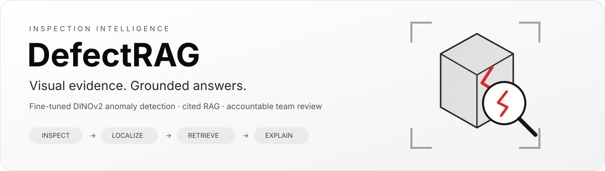
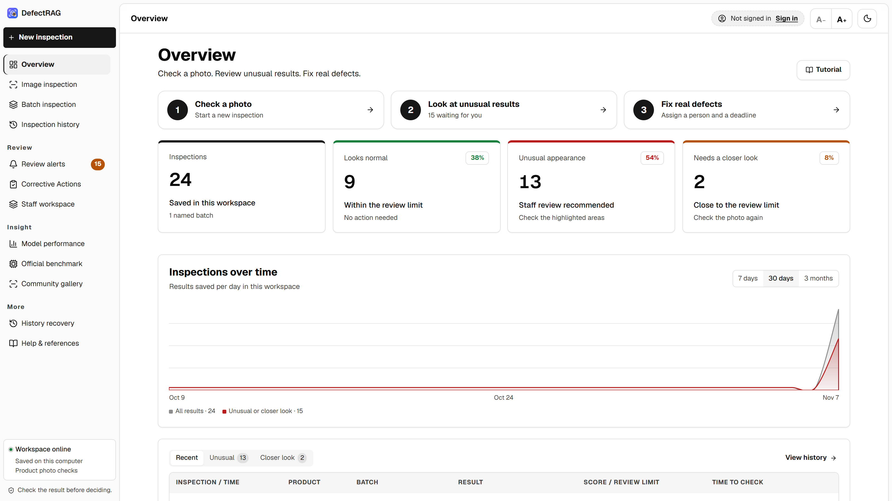
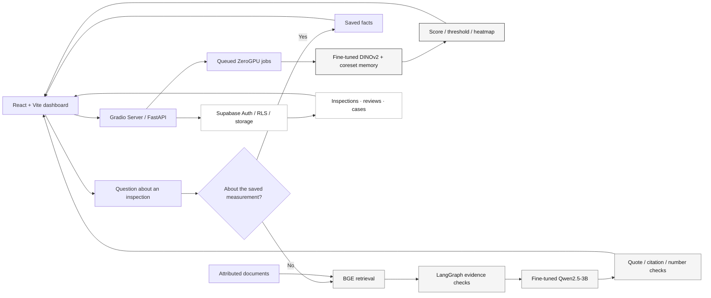
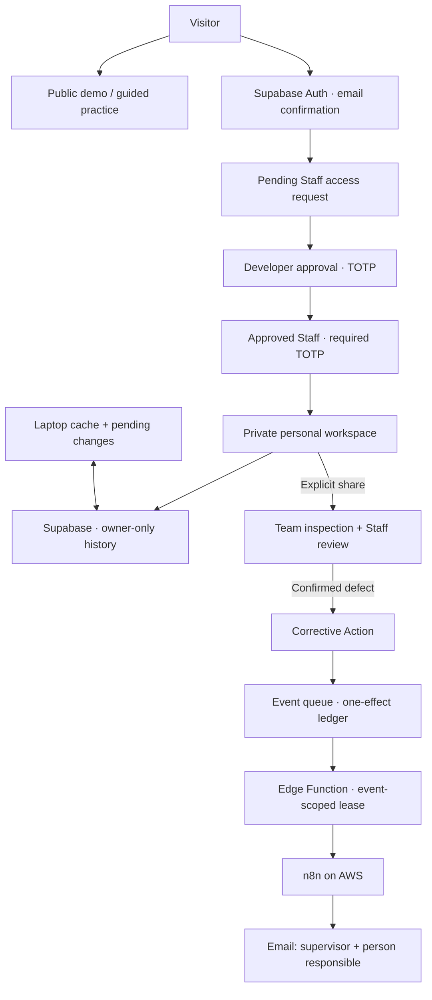

<div align="center">
  <picture>
    <source media="(prefers-color-scheme: dark)" srcset="docs/assets/hero-dark.svg" />
    
  </picture>

  <p><strong>Industrial visual inspection with a fine-tuned vision model and an evidence-grounded assistant.</strong><br/>
  Take a photo of a product. See if it looks unusual, see where, and ask why.</p>

  <a href="https://huggingface.co/spaces/Wizzas/DefectRAG"></a>
  
  
  
  <br/>
  
  
  
  
  
  <br/>
  
  
  
  
  
  
  
  
  
  <a href="https://github.com/WAYTECHG/DefectRAG/actions/workflows/ci.yml"></a>
  <a href="https://github.com/WAYTECHG/DefectRAG/actions/workflows/release.yml"></a>

  <p><a href="https://huggingface.co/spaces/Wizzas/DefectRAG">Live demo</a> · <a href="#features">Features</a> · <a href="#results">Results</a> · <a href="#how-it-works">How it works</a> · <a href="#quick-start">Quick start</a> · <a href="#documentation">Docs</a> · <a href="docs/STAFF_QUICK_GUIDE.md">Staff guide</a></p>
</div>

<p align="center">
  <picture>
    <source media="(prefers-color-scheme: dark)" srcset="docs/assets/screenshots/result-compare-dark.png" />
    
  </picture>
  <picture>
    <source media="(prefers-color-scheme: dark)" srcset="docs/assets/screenshots/overview-dark.png" />
    
  </picture>
</p>

## Overview

DefectRAG checks product photos for unusual appearance and explains its results. A fine-tuned **DINOv2** vision model
compares each photo with a memory of normal photos of the same product and highlights the areas that do not match. An
inspection-linked assistant answers questions with sentences quoted from the project's attributed documents, generated
by a **QLoRA-fine-tuned Qwen2.5-3B** and checked before they are shown. Staff review results, share them with the team
and turn confirmed defects into Corrective Actions with an owner, a deadline and email notifications.

| Visual inspection | Evidence-grounded assistant | Accountable team review |
|---|---|---|
| Fine-tuned DINOv2 features across 12 VisA products | BGE retrieval over attributed documents | Supabase authentication, row-level security and TOTP MFA |
| Nearest-normal difference scores with one threshold rule | LangGraph routing, Qwen generation and citation checks | Private personal history, explicit team sharing |
| Patch-level heatmaps and a side-by-side compare view | Saved measurements kept separate from document claims | Corrective Actions with live email reminders through n8n |

> **Operating scope:** appearance screening on benchmark products. Scores are distances, not defect probabilities. The
> product category is chosen by the operator, and a person makes the final decision.

## Features

| Feature | What it does |
|---|---|
| **Image and batch inspection** | Pick a product, upload one photo or a batch, get *Looks normal*, *Needs a closer look* or *Unusual appearance* with the unusual areas highlighted. Zoom, drag and compare the photo with the heatmap. |
| **Evidence assistant** | Ask about a result. Answers quote the project's documents with sources, and say so when the documents cannot answer. Questions about the score or verdict are answered from the saved measurement, not generated. |
| **Staff review and team sharing** | Save structured reviews (Accept / Hold / Reject), share a separate copy to the team workspace, acknowledge alerts, mark all as seen. |
| **Corrective Actions** | Turn a confirmed defect into a case with a person responsible, a supervisor and a due date. Emails go out instantly on each change and as due-soon and overdue reminders. |
| **Secure accounts** | Email-confirmed registration, developer approval, native TOTP MFA, enforced in the database with row-level security and protected storage. |
| **Local and cloud** | The same account works in the hosted app and on a laptop, with private history synchronised both ways and explicit handling of conflicts. |
| **Reports and recovery** | Printable reports, CSV exports, recoverable archiving, and a support-details copy that never includes passwords or photos. |
| **Accessible interface** | Black-and-white light and dark themes, text-size controls, phone and tablet layouts, and a guided practice that walks through the real screens without saving anything. |

## Results

All detector numbers are on the official VisA test split: **12 products, 2,400 test photos**. Every product uses the
**same threshold rule**, the one the app uses: the limit is set so that about 5 in 100 normal reference photos are
flagged (the 95th percentile of held-out normal scores).

| Detector | AUROC | Defects caught | Normal photos flagged |
|---|---:|---:|---:|
| Pretrained DINOv2 (frozen) with a random-sample memory | 0.950 | 83.8% | 7.4% |
| **Fine-tuned DINOv2 with a coreset memory (deployed)** | **0.971** | **90.7%** | **7.0%** |

AUROC measures how well the scores separate normal from defective photos (1.0 = perfect, 0.5 = chance), independently of
the threshold.

### What improved the detector, one change at a time

| Step | Change | Mean AUROC | Three weakest products | Macaroni 2 |
|---|---|---:|---:|---:|
| 0 | Pretrained DINOv2 (frozen), memory of randomly sampled normal patches | 0.950 | 0.887 | 0.845 |
| 1 | Memory chosen by greedy farthest-point selection (a coreset), same size | 0.969 | 0.925 | 0.880 |
| 2 | Last 4 of 12 encoder blocks fine-tuned on synthetic defects (deployed) | **0.971** | **0.934** | **0.897** |

The coreset is the main gain and it also holds on a second dataset. The fine-tune adds a small gain that is clear on
Macaroni 1, Macaroni 2 and PCB 1. Rotated training views, a second backbone, global and position-aware distances, score
fusions and a simpler fine-tune were also tested and did not help; all of it is documented in
[the experiments](docs/ENCODER_DIAGNOSTIC.md).

### Generalisation check on MVTec AD

The three detector variants were scored **once** on MVTec AD (15 other products, 1,725 test images), with the protocol
written before any score existed ([protocol and results](docs/MVTEC_EVALUATION.md)). The vision model was never trained
on MVTec.

| MVTec AD, mean over 15 products | Random-sample memory | Coreset memory | Coreset + VisA fine-tuned encoder |
|---|---:|---:|---:|
| Image AUROC | 0.986 | **0.992** | **0.992** |
| Image average precision | 0.995 | 0.997 | 0.998 |
| Pixel AUROC | 0.886 | 0.888 | 0.881 |

The coreset gains clearly on cable, pill and screw with no product clearly worse. The VisA fine-tune adds nothing
measurable here (one product clearly better, one clearly worse), so its small VisA gain is not confirmed elsewhere.

<details>
<summary><strong>Per-product results (VisA and MVTec AD)</strong></summary>

**VisA, deployed detector, same q95 rule for every product**

| Product | Image AUROC (before → now) | Pixel AUROC | Defects caught | Normal flagged |
|---|---:|---:|---:|---:|
| PCB 1 | 0.960 → **0.979** | 0.995 | 94% | 9% |
| Capsules | 0.968 → **0.978** | 0.978 | 96% | 7% |
| Cashew | 0.961 → **0.974** | 0.997 | 94% | 8% |
| Candle | 0.941 → **0.960** | 0.992 | 86% | 9% |
| Chewing gum | 0.989 → **0.992** | 0.996 | 96% | 6% |
| Fryum | 0.992 → **0.990** | 0.981 | 96% | 4% |
| Macaroni 1 | 0.909 → **0.947** | 0.996 | 75% | 4% |
| Macaroni 2 | 0.845 → **0.897** | 0.994 | 73% | 9% |
| PCB 2 | 0.906 → **0.958** | 0.972 | 87% | 10% |
| PCB 3 | 0.955 → **0.993** | 0.980 | 98% | 13% |
| PCB 4 | 0.987 → **0.995** | 0.983 | 95% | 2% |
| Pipe fryum | 0.989 → **0.991** | 0.993 | 99% | 4% |

**MVTec AD, image AUROC** (random memory / coreset / coreset + fine-tune)

| Product | AUROC | Product | AUROC | Product | AUROC |
|---|---|---|---|---|---|
| Bottle | 1.000 / 1.000 / 1.000 | Hazelnut | 1.000 / 0.999 / 0.999 | Tile | 1.000 / 1.000 / 1.000 |
| Cable | 0.961 / 0.984 / 0.993 | Leather | 1.000 / 1.000 / 1.000 | Toothbrush | 1.000 / 1.000 / 1.000 |
| Capsule | 0.958 / 0.966 / 0.967 | Metal nut | 1.000 / 1.000 / 1.000 | Transistor | 0.997 / 1.000 / 1.000 |
| Carpet | 1.000 / 1.000 / 1.000 | Pill | 0.977 / 0.992 / 0.996 | Wood | 0.980 / 0.986 / 0.974 |
| Grid | 1.000 / 1.000 / 1.000 | Screw | 0.923 / 0.963 / 0.961 | Zipper | 0.993 / 0.994 / 0.996 |

</details>

### Evidence assistant (fine-tuned Qwen2.5-3B)

QLoRA fine-tuning (4-bit base, LoRA rank 16, 0.96% of weights trained, 400 examples, 50 minutes on an 8 GB laptop GPU).
Scored on 100 held-out questions (80 answerable, 20 that the documents cannot answer); an answer counts only if every
quoted sentence is the expected one. The same Qwen2.5-3B was measured before and after fine-tuning in each place it runs:

| Where it runs | Before fine-tuning | After fine-tuning | Seconds per answer (after) |
|---|---:|---:|---:|
| Python test server, 4-bit | 42% correct · answered 6 of 20 it should refuse | **89%** correct · **0** of 20 | 11.6 |
| Ollama on the laptop (output format enforced) | 61% · 8 of 20 | **86%** · **0** of 20 | 1.1 |
| Hugging Face Space, 16-bit | not measured | **92%** · 2 of 20 | 2.6–2.9 |

The "before" scores differ between rows because the runtime differs, not the model: Ollama forces the answer into the
expected JSON shape, which the plain test server does not. Compare along a row, not down a column.

Details, a second question set and caveats: [language-model card](docs/model-cards/QWEN_MODEL_CARD.md).

### Limitations

- Only the 12 VisA product types were tested; other products, cameras and lighting are untested.
- The VisA test photos were seen during development and several variants were scored on them, so those figures are
  descriptive, not independent validation. The MVTec check was one run on a mirror copy of the dataset.
- **Macaroni is the weak spot:** small edge chips are hard to see, so Macaroni 1 and 2 catch 75% and 73% of defects
  under the one rule, against 86–99% for the other products.
- Heatmaps are interpolated patch distances, not segmentation; on texture surfaces localisation is weak.
- The assistant generalises less than its headline suggests: 86–92% on held-out questions phrased like the training
  questions, but 56–65% on a separate set of newcomer-style questions. All were written with AI help; real users may do
  worse.
- A screening aid, not an approved factory procedure or acceptance specification.

## How it works

1. **Look.** DINOv2 cuts the photo into 14-pixel patches and compares each one with a memory of 32,768 patches taken from
   normal photos of that product. The memory is chosen by farthest-point selection so that rare but normal details are
   kept. Patches with no close match form the heatmap, and the most unusual ones give the difference score.
2. **Decide.** Every product has a limit set from held-out normal photos only. Above it is *unusual*, within 5% of it is
   *closer look*.
3. **Explain.** BGE retrieves the most relevant sentences, LangGraph checks scope and evidence, the fine-tuned Qwen picks
   and restates the answering sentence, and quotes, citations and numbers are validated before display.



<details>
<summary><strong>Accounts, approval and email automation</strong></summary>



Access rules, MFA and case ownership are enforced below the frontend. Saving a case never depends on email: if delivery
fails, the case stays saved and the event waits in the queue. See [Security](docs/SECURITY.md).
</details>

## Tech stack

| Layer | Technology |
|---|---|
| Vision | DINOv2 ViT-S/14 (last 4 blocks fine-tuned), PyTorch 2.8, farthest-point coreset memory, 448 px input |
| Language | Qwen2.5-3B-Instruct, QLoRA (4-bit NF4, LoRA rank 16), merged; Ollama Q8_0 copy for laptops |
| Retrieval | BGE-small-en-v1.5, LangChain loaders, LangGraph workflow with citation and number validation |
| Serving | Hugging Face Space, Gradio 6.30 Server mode, FastAPI, ZeroGPU queue; Uvicorn locally |
| Frontend | React 19, Vite 6, design tokens with light and dark themes |
| Data and auth | Supabase Postgres, row-level security, storage, Auth with TOTP MFA; SQLite locally |
| Automation | n8n on AWS Lightsail, Supabase Edge Functions, Resend |
| Quality | GitHub Actions CI (ruff, mypy, pytest, frontend tests and builds), Dependabot, one-click release with approval |

## Quick start

**Online:** open the [live demo](https://huggingface.co/spaces/Wizzas/DefectRAG). It runs on a shared free GPU, so the
first request can be slow; anonymous history is temporary.

**Run locally** (Windows, Python 3.11, Node.js):

```powershell
git clone https://github.com/WAYTECHG/DefectRAG.git
cd DefectRAG
py -3.11 -m venv .venv
.\.venv\Scripts\python.exe -m pip install -r requirements.txt
.\.venv\Scripts\python.exe -m scripts.fetch_public_assets   # downloads the models and verifies their checksums
.\Start-DefectRAG.cmd -Port 8767
```

Then open http://127.0.0.1:8767. A GPU is optional. For local explanations install [Ollama](https://ollama.com) with
`qwen2.5:3b`. Sign-in, the team workspace and emails need your own Supabase and email setup ([Setup](docs/SETUP.md)).
This recipe was not re-tested on a completely fresh machine.

**Development checks:**

```powershell
python -m ruff check .
python -m mypy backend
python -m pytest tests -q
npm test --prefix frontend
```

## Project structure

```text
backend/              Visual scoring, RAG workflow, API and persistence
frontend/             React dashboard and design tokens
knowledge/            Attributed documents the assistant quotes
deployment/space/     Hugging Face Space adapter, release and verification tools
scripts/              Training, evaluation, asset and export tools
tests/                API, model-profile, calibration, security and answer checks
docs/                 Guides, model cards, experiments and the operations runbook
results/              Published evaluation summaries
```

## Documentation

| Document | Contents |
|---|---|
| [Detector model card](docs/model-cards/DETECTOR_MODEL_CARD.md) | What the vision model is, how it was trained, per-product results, limits |
| [Language model card](docs/model-cards/QWEN_MODEL_CARD.md) | The fine-tuned Qwen: method, data, evaluation, known failures, licence |
| [Detector experiments](docs/ENCODER_DIAGNOSTIC.md) | Every variant tried, including the ones that did not help |
| [MVTec AD check](docs/MVTEC_EVALUATION.md) | The pre-written protocol and the one-run results |
| [Qwen fine-tuning](docs/QWEN_FINETUNING_RESULTS.md) | Full tables and how to repeat the training |
| [Setup](docs/SETUP.md) · [Security](docs/SECURITY.md) · [Operations](docs/OPERATIONS.md) · [Architecture](docs/ARCHITECTURE.md) | Running, securing and maintaining the system |
| [Staff guide](docs/STAFF_QUICK_GUIDE.md) | How staff use the dashboard |

## Validation

- **494 automated tests passing** (274 frontend, 220 backend, 2 skipped), plus an automatic text-contrast audit of 13
  screens in both themes.
- The deployed detector reproduces the experiment scores exactly through the app's own code path, and the live Space
  matches the local app within 0.0003 on 24 real inspections across all 12 products.
- Detector releases to the Space are first rebuilt from the live snapshot and booted locally, and every release
  keeps a saved rollback.
- Corrective Action emails were verified end to end: each recipient received every email once, with a provider receipt.

## Future work

- Validation on real production photos instead of benchmark images.
- Better detection of small structural defects such as macaroni edge chips.
- Multimodal RAG: today the assistant reads the saved measurements, not the image pixels.

## Credits and licences

Application code: [MIT](LICENSE). Models and datasets keep their own licences; see the
[third-party notices](docs/THIRD_PARTY_NOTICES.md).

- [VisA](https://github.com/amazon-science/spot-diff), Zou et al., ECCV 2022: CC BY 4.0.
- [MVTec AD](https://www.mvtec.com/company/research/datasets/mvtec-ad), Bergmann et al., CVPR 2019 / IJCV 2021: CC BY-NC-SA 4.0, used only for one evaluation.
- [DINOv2](https://github.com/facebookresearch/dinov2), Meta: Apache-2.0. The deployed weights are a modified copy, not an official Meta release.
- [Qwen2.5-3B-Instruct](https://huggingface.co/Qwen/Qwen2.5-3B-Instruct): **Improved using Qwen.** Qwen Research License, non-commercial, so the fine-tuned model is not covered by the MIT licence.
- [BGE-small-en-v1.5](https://huggingface.co/BAAI/bge-small-en-v1.5) for retrieval. [AnomalyDINO](https://github.com/dammsi/AnomalyDINO) and PatchCore inspired the memory design; this is a custom adaptation, not a reproduction.
