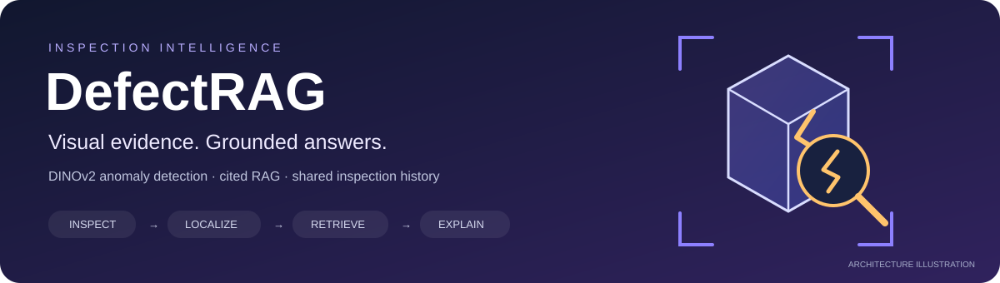
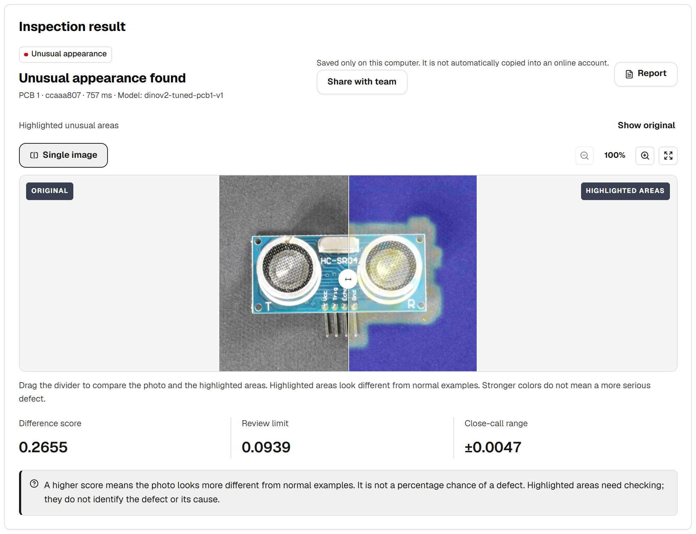
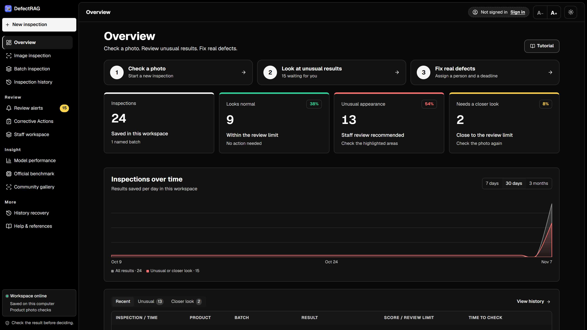
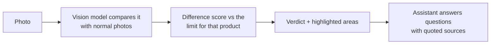

<div align="center">
  

  <p><strong>Take a photo of a product. See if it looks unusual, see where, and ask why.</strong></p>

  <a href="https://huggingface.co/spaces/Wizzas/DefectRAG"></a>
  <a href="https://github.com/WAYTECHG/DefectRAG/actions/workflows/ci.yml"></a>
  
</div>

<p align="center">
  
  
</p>

## What it does

- **Checks a photo.** Pick one of 12 product types, add a photo, and get *Looks normal*, *Needs a closer look* or *Unusual appearance*, with the unusual areas highlighted.
- **Explains the result.** Ask a question and the assistant answers with sentences quoted from the project's own documents, shows where each one came from, and says so when the documents don't cover it.
- **Keeps people in charge.** Staff review each result, assign a fix to a person with a deadline, and the team sees what is still open. Corrective Action emails reach the person responsible.
- **Runs two ways.** Online in the browser, or on your own computer where photos stay on that computer.

DefectRAG is a screening aid. A person always makes the final call, and the score is a distance, not a chance of a defect.

## How it works



1. **Look.** A vision model (DINOv2) cuts the photo into small patches and compares each one with a memory of 32,768 patches taken from normal photos of the same product. A patch with no close match is unusual. It learns only from normal photos, so it needs no examples of defects.
2. **Decide.** Every product has a limit. A score above it is *unusual*, a score close to it is *closer look*.
3. **Explain.** The assistant finds the most relevant sentences in the documents, a small language model (Qwen2.5-3B, fine-tuned for this job) picks the one that answers the question, and the app checks the quote before showing it. **Improved using Qwen.**

## Results

Measured on the VisA dataset: 12 product types, 2,400 test photos. **One rule for every product**, macaroni included, and the same rule the app uses: the limit is set so that about 5 in 100 normal reference photos would be flagged.

| | Before | Now |
|---|---:|---:|
| Separates normal from unusual (AUROC, 1.0 = perfect, 0.5 = coin flip) | 0.950 | **0.971** |
| Defects caught, with the same rule for all 12 | 83.8% | **90.7%** |
| Normal photos flagged by mistake | 7.4% | **7.0%** |

What made the difference, one change at a time:

| Step | AUROC |
|---|---:|
| Start: pretrained vision model, memory of randomly picked normal patches | 0.950 |
| A smarter memory: pick the most varied normal patches instead (same size) | 0.969 |
| Also fine-tune the model's last layers on synthetic defects (what runs now) | **0.971** |

The smarter memory is the big win, and it also held on a second dataset (MVTec AD, 15 other products: 0.986 to 0.992). The fine-tune is a small extra gain that I could not confirm on that second dataset. Ideas that did not help are written up too, in [the experiments](docs/ENCODER_DIAGNOSTIC.md).

**The assistant:** fine-tuning picked the right source sentence for 89% of 100 held-out questions, against 42% for the same model without it, and it stopped answering questions the documents cannot answer.

### Honest limits

- Only the 12 VisA product types were tested. Other products, cameras or lighting are untested.
- I saw the test photos while building this, so the numbers are descriptive, not independent proof. The MVTec check was run once, with the plan written first.
- **Macaroni is the weak spot.** Small chips on the edges are the hardest case, so with the one rule Macaroni 1 and 2 catch about 75% and 73% of defects, against 86% to 99% for the other products. A more sensitive limit would catch about 90% but flag 20% to 27% of normal macaroni photos; I kept one rule for fairness.
- The assistant was tested on questions written with AI help, so real users may do worse.
- Not an approved factory procedure.

## Try it

**Online:** [the live demo](https://huggingface.co/spaces/Wizzas/DefectRAG). It runs on a shared free GPU, so the first request can be slow. Anonymous history is temporary.

**On your computer** (Windows, Python 3.11, Node.js):

```powershell
git clone https://github.com/WAYTECHG/DefectRAG.git
cd DefectRAG
py -3.11 -m venv .venv
.\.venv\Scripts\python.exe -m pip install -r requirements.txt
.\.venv\Scripts\python.exe -m scripts.fetch_public_assets   # downloads the models and checks their checksums
.\Start-DefectRAG.cmd -Port 8767
```

This recipe was not re-tested from a completely fresh machine. A GPU is optional. Sign-in, the team workspace and emails need your own Supabase and email setup: see [Setup](docs/SETUP.md).

## Learn more

[Staff guide](docs/STAFF_QUICK_GUIDE.md) · [Setup](docs/SETUP.md) · [Security](docs/SECURITY.md) · [Operations](docs/OPERATIONS.md) · [Architecture](docs/ARCHITECTURE.md)
[Detector model card](docs/model-cards/DETECTOR_MODEL_CARD.md) · [Language model card](docs/model-cards/QWEN_MODEL_CARD.md) · [Experiments](docs/ENCODER_DIAGNOSTIC.md) · [MVTec check](docs/MVTEC_EVALUATION.md)

Built with PyTorch, FastAPI, React, LangGraph, Supabase and Gradio on Hugging Face ZeroGPU.

## Credits and licences

Application code: [MIT](LICENSE). Models and data have their own licences; see [third-party notices](docs/THIRD_PARTY_NOTICES.md).

- [VisA](https://github.com/amazon-science/spot-diff), Zou et al., ECCV 2022: CC BY 4.0.
- [MVTec AD](https://www.mvtec.com/company/research/datasets/mvtec-ad), Bergmann et al., CVPR 2019 / IJCV 2021: CC BY-NC-SA 4.0, used only for one evaluation.
- [DINOv2](https://github.com/facebookresearch/dinov2), Meta: Apache-2.0. The deployed weights are a modified copy, not an official Meta release.
- [Qwen2.5-3B-Instruct](https://huggingface.co/Qwen/Qwen2.5-3B-Instruct): **Improved using Qwen.** Qwen Research License, non-commercial, so the fine-tuned model is not covered by the MIT licence.
- [BGE-small-en-v1.5](https://huggingface.co/BAAI/bge-small-en-v1.5) for retrieval. [AnomalyDINO](https://github.com/dammsi/AnomalyDINO) inspired the memory and foreground steps; this is a custom adaptation, not a reproduction.
