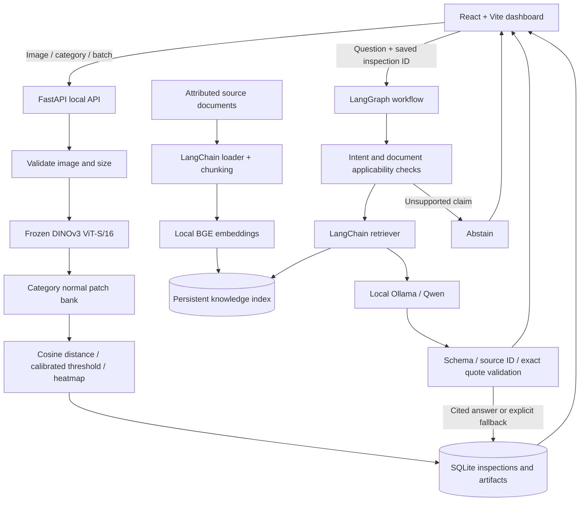

# Architecture

`Detector` serializes inference and loads assets lazily. A failed model call does
not create a successful inspection. SQLite transactions store the inspection and
its local alert; conversation turns are stored together. `InspectionRepository`
defines the persistence boundary for a future isolated cloud implementation.

Training/fitting and final evaluation run outside request handling. The application
does not refit models on startup or use newly uploaded images to alter thresholds.
Knowledge fingerprints bind vectors and conversation context to source/embedding
versions. Image measurements remain separate from general documentation.

This is a local single-user deployment. Static public hosting alone cannot execute
the Python detector; a separate secured inference service is required. No model
weights, credentials or private histories are sent to an external AI API.
