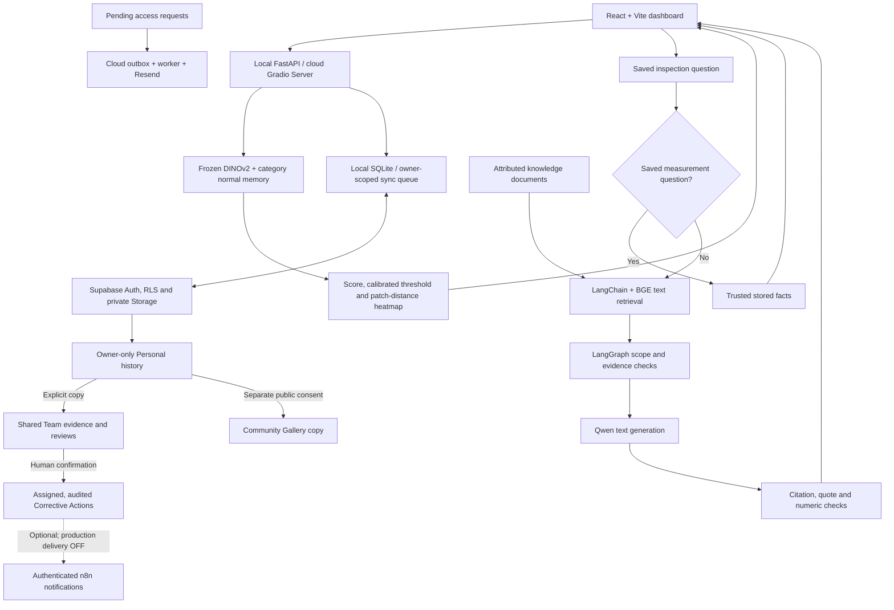

# Architecture

DefectRAG combines frozen visual anomaly scoring, vision-assisted text RAG and
separate private, shared and public workspaces. The React/Vite dashboard is shared
between the local FastAPI application and Gradio Server/FastAPI cloud adapter.

## Visual inspection

The deployed high-resolution profile uses frozen DINOv2 ViT-S/14 at a448px short
edge with normal patch memory and a PCA foreground heuristic. Original DINOv3
profiles remain for comparison. Inference compares patch features with normal
references; it does not retrieve historical inspection photographs for the RAG
assistant. Scores and thresholds are stored with the actual model/policy identity.
No encoder fine-tuning occurs. The selected product is an operator input.

Normal-only calibration is separate from model fitting and benchmark ranking.
The Macaroni q80 policy changes operating recall and false alarms, not AUROC or
weights. Ground-truth masks are used for evaluation only. See
[metrics](ACCURACY_AND_METRICS.md) and [model process](TRAINING_AND_EVALUATION.md).

## Evidence Assistant

BGE embeds text passages from attributed knowledge documents. LangChain supports
loading/chunking and retrieval; LangGraph routes measurement questions, applies
scope/evidence rules and coordinates generation/validation. Direct score/verdict
questions can use stored facts without an LLM call. Other supported questions use
Qwen with retrieved text, measurement context and conversation.

Cloud retrieval uses a CPU-only embedding worker and Qwen3-4B on queued ZeroGPU;
local generation uses the configured Ollama model. Qwen receives no image pixels
or visual embeddings. This is vision-assisted text RAG, not Multimodal RAG. The
assistant does not diagnose named defects or prescribe factory repair procedures.

## Storage, access and synchronization

SQLite retains local records and pending operations. Supabase is the online
source of truth for approved-account Personal data, not an automatic public store.
Images, heatmaps, conversations, notes, archive state and versioned receipts have
explicit synchronization paths. Duplicate operations and conflicts are handled
without silently overwriting both sides. Offline pending work is not cloud-saved.

Native Supabase membership and TOTP assurance guard protected backend operations,
RPCs, RLS and storage. A new registered account is Pending until Developer approval.
Personal, Team, Gallery and guest data stay distinct. Sharing is explicit; revoking
access stops new protected operations. See [security](SECURITY.md).

## User workflow and automation

The action-led tutorial uses isolated in-memory teaching state on the real page
routes. It temporarily replaces live-operation panels and pauses workspace polling;
it does not grant roles or change saved work. Original teaching images/heatmaps
are bundled under supported hashed asset routes. [Practice design](GUIDED_PRACTICE.md).

Developer request emails use a durable cloud outbox/Cron/Edge/Resend path independent
of a local laptop. Corrective Actions reuse separate secured n8n notification
workflows. Their local sink/callback integration is verified; unattended real
reminders/escalations require hosting and separate activation. n8n performs no
model inference, OTP verification or account approval.
