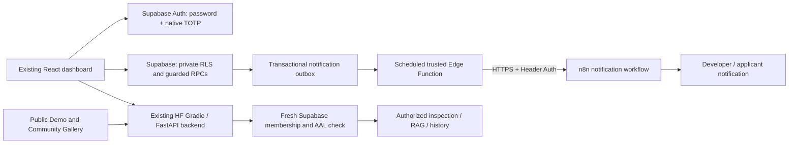

# Native MFA and notification automation: architecture assessment

Date: 20 October 2026. Baseline: `d0ff630`, explicitly selected by the user.
Status: proposal only; no application, migration, authentication setting, deployment or email changes.

## Confirmed baseline

- `frontend/src/TeamWorkspace.jsx:71`: Supabase password sign-in and reset. There is no registration, access-request, developer approval/rejection or MFA interface in this checkpoint. The developer recovery interface is not an approval workflow.
- `frontend/src/cloud.js:25`: `currentStaff()` validates the user through Supabase, then reads `staff_members`. Browser clients also access private tables and Storage directly.
- `deployment/supabase.sql:4`: authoritative staff allowlist. `defectrag_is_staff()` at line 10 and `defectrag_is_developer()` at line 14 check membership/role, without MFA assurance. Membership mutation is not granted to browser roles; setup uses manual invitations and allowlist entries.
- `deployment/supabase.sql:40`: Team data policies depend on those helpers. The personal-workspace migration, conversation RPCs, private Storage and developer recovery depend on the same authorization boundary. Security-definer functions need explicit checks; table RLS alone does not protect their privileged execution.
- `deployment/space/supabase_repository.py:29`: `StaffRepository` forwards each user's JWT to Supabase rather than trusting decoded claims. Lines 39–52 cache the membership result for 45 seconds. Subsequent database requests still run under RLS; this is not a claim that every request bypasses RLS for 45 seconds.
- `deployment/space/supabase_repository.py:85`: private image links are signed for 600 seconds. Previously issued bearer URLs do not become invalid immediately after a membership change.
- `deployment/space/sessions.py:22`, `:36`, `:64`, `:97`: remembered tokens, artifact capabilities and `SessionRepository.current()` must participate in MFA/revocation checks.
- `deployment/space/app.py:207` and `:215`: queued inspection and assistant authorization must remain before GPU/model work. Protecting only HTTP pages would miss these entry points.
- `frontend/package.json:14`: existing Supabase JS dependency supports native MFA; a new authentication vendor is unnecessary.

No native MFA, n8n dispatcher, notification outbox or access-request state machine was found. The proposed change therefore adds the missing request/approval layer while preserving the allowlist. No other branch is assumed to contain it.

## Recommended architecture

Supabase remains the identity and authorization authority. n8n delivers notifications only: no OTP creation, verification, approval authority, session handling or team-data access.

### Identity, approval and enrollment

1. Retain password login. Use native Supabase email verification for external registration and native TOTP for the second factor. Email OTP/confirmation alone is not AAL2 MFA.
2. Add a minimal access-request table: pending, approved, rejected and revoked, with version and audit actor/time. Verified users can submit/read only their own request. Existing allowlisted accounts remain approved.
3. Developer decision RPCs require fresh active developer membership and AAL2, lock/check the request state, and atomically update membership, decision audit and notification outbox. Applicants cannot choose a privileged role. New approvals grant staff, never developer, through the applicant workflow.
4. Reject unauthorized, self-promoting or stale/concurrent decisions. Define last-developer protection and an explicit Supabase-admin recovery procedure; no email approval links that execute decisions and no n8n bypass.
5. Add native `auth.mfa.enroll`, `listFactors`, `challenge`, `verify` and `getAuthenticatorAssuranceLevel` flows within the existing design. QR codes/seeds are transient enrollment material and must not enter logs, notifications or application tables.
6. Provide an AAL1 endpoint for the user's own approval/enrollment status only. It must not expose the staff directory or private records. This prevents an MFA bootstrap deadlock.

### Enforcement and revocation

- Require active approved membership plus verified AAL2 for both Staff and Developer private operations after separately approved activation. Do not condition enforcement merely on whether the browser reports an enrolled factor.
- Apply server checks, restrictive RLS where applicable, private Storage policies and explicit checks inside every privileged security-definer RPC. Audit all existing grants/policies so permissive policies cannot create an OR-based bypass.
- Reuse user-JWT Supabase requests. Prefer a narrow authenticated posture RPC so Supabase validates claims and returns current membership/assurance. Never accept a browser-supplied role or unverified decoded JWT as authority.
- Remove stale authorization decisions from revocation-sensitive preflight checks; refresh/reset session state on MFA/auth events. Check current factor posture where necessary: previously issued AAL2 JWTs can outlive factor removal until refresh.
- Cover queued Gradio requests, exports, report/image capabilities, private-source Gallery publication and moderation. Pending/rejected/revoked users remain denied even with a valid AAL2 session.
- Replace private signed-link delivery with authenticated fetching/proxy checks if immediate future-access revocation is required. Drain old 600-second links before claiming full coverage. Already downloaded copies cannot be revoked.
- Do not apply private MFA policies indiscriminately to public Gallery or guest-demo paths. Demo remains isolated and usable without an account.
- Enroll and verify the existing developer before activation. Password reset does not silently bypass MFA; lost-factor recovery needs an explicit administrative process.

### Durable notifications and n8n

- Insert outbox events in the same transaction as the request or decision. Permission changes never depend on an email request or its success.
- Use a scheduled trusted Supabase Edge Function to claim leased jobs, send notifications, retry with bounded backoff and retain dead-letter events for controlled retry. This runs independently of the sleeping HF Space. Hosting availability and limits must be confirmed before activation; no paid service is selected.
- Authenticate the worker invocation with a purpose-scoped server credential, not a public publishable key. Protect the production n8n HTTPS webhook with native Header Auth. Keep secrets in trusted server configuration/Vault, never React. n8n needs no Supabase service-role key.
- Send only stable event ID, request ID/version/type, verified recipient and minimal notification text. No team records, image links, scores, conversations, JWTs or MFA secrets. Minimize/redact execution logs and configure retention.
- Request-submitted events notify developers; approved/rejected events notify applicants. Links lead to normal authenticated pages, with no confidential decision context in URLs.
- Use unique event keys and conditional transitions to prevent duplicate grants/events. Supersede stale queued decisions after revocation. Authorization always comes from the current database state, not an email.
- Acknowledge delivery only after the workflow/provider accepts the message, not n8n's immediate 'workflow started' response. For asynchronous completion, an authenticated callback/poll is required.
- Delivery is at least once. Use provider idempotency when available. SMTP can still duplicate mail after an ambiguous send/ack failure; do not promise exactly-once delivery. n8n node retries alone do not recover requests made while n8n is down, hence the external outbox.
- n8n hosting has not been confirmed. No workflow, SMTP account or paid resource is provisioned by this assessment.

## SMTP prerequisites

Supabase's default Auth mail service is restricted to project-organization team addresses, currently limited to two messages per hour and unsuitable for normal external-user onboarding. Supabase organization membership is distinct from the application's staff allowlist. Confirm the existing project's configuration before drawing conclusions about its actual delivery.

External sign-up verification, invitations and password resets require configured custom SMTP. Required settings include server/port/TLS, server-side credentials, verified sender/domain, SPF/DKIM and appropriate DMARC, allowed redirects/Site URL, and abuse/rate-limit controls. n8n decision notifications need separately configured server-side delivery credentials; this does not replace Supabase Auth mail. TOTP itself uses an authenticator and needs no email transport.

## Verification plan and gates

No new MFA, approval, SMTP or n8n tests have run: these features do not exist in the baseline. Prior application tests remain historical evidence, not proof of new controls.

| Test group | Required evidence before activation |
| --- | --- |
| Native MFA | Valid challenge upgrades to AAL2; invalid/expired code does not. Enrollment cancellation, removed factors, stale sessions and invalid JWTs fail closed. |
| Approval | Pending/rejected/revoked accounts denied at AAL1 and AAL2; staff cannot approve/promote; developer AAL2 succeeds; concurrent/duplicate transitions are safe. |
| Direct access | Test REST tables, RLS, RPCs, private Storage, queued inference/RAG, image/report/export capabilities, Gallery private-source publishing and moderation. |
| Notifications | Fake n8n/mail sink: timeout, 401, 500, outages, retry exhaustion, duplicate events, stale decision events, lease recovery and ambiguous delivery. Login and committed decisions remain unaffected. |
| Revocation | Still-valid JWT cannot obtain new private data or GPU work; cached decisions do not grant access; record signed-link/download limitations. |
| Regression | Public Demo, original React design, existing Staff/Personal workspaces, owner isolation, Gallery and recovery preserved. No model experiments required. |

Start with offline/mocked tests and fake delivery. Real Supabase MFA, live RLS, approval and notification tests require separate approval and appropriate test accounts. The prior checkpoint had only a developer-role live account; a real regular-staff and authenticated non-staff account are still needed for complete live evidence.

## Proposed implementation milestones

1. Approve this architecture and confirm available n8n hosting and SMTP provider. No paid assumption.
2. Prepare isolated code, a new reviewable additive migration, inactive configuration and fake-delivery tests. Preserve already executed SQL and all existing records. Review the full changed-policy/RPC matrix.
3. After explicit permission, manually apply the reviewed migration and deploy inactive-compatible code. Verify current app still works before activating MFA. Bootstrap and test developer TOTP safely.
4. With explicit activation permission, enforce MFA and run approved account-level/live security tests. Enable notifications only after webhook/SMTP review and permission to send test mail.
5. Record measured passes and untested cases, preserve a Git checkpoint and provide rollback/recovery instructions. No automatic auth activation or deployment is authorized by this assessment.

## Official references

- [Supabase MFA and assurance](https://supabase.com/docs/guides/auth/auth-mfa)
- [Native TOTP enrollment and verification](https://supabase.com/docs/guides/auth/auth-mfa/totp)
- [Supabase SMTP restrictions and setup](https://supabase.com/docs/guides/auth/auth-smtp)
- [Supabase scheduled Edge Functions](https://supabase.com/docs/guides/functions/schedule-functions)
- [Supabase RLS](https://supabase.com/docs/guides/database/postgres/row-level-security)
- [n8n Webhook authentication and response modes](https://docs.n8n.io/integrations/builtin/core-nodes/n8n-nodes-base.webhook/)
- [n8n error handling](https://docs.n8n.io/flow-logic/error-handling/)

Documentation reviewed on 20 October 2026. Actual project MFA/SMTP configuration, hosting quotas and delivery are unverified; no secrets were inspected.
