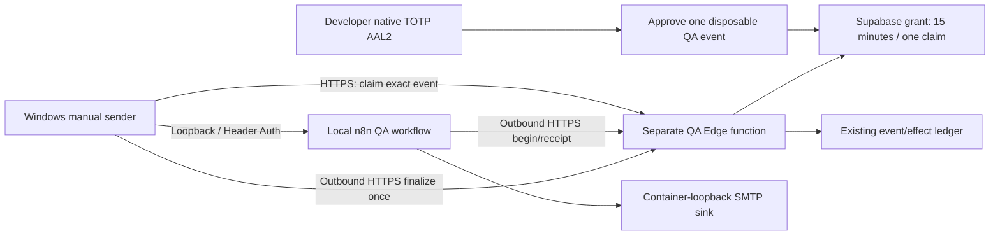

# One-event local/cloud QA bridge — INACTIVE, review required

CURRENT25October15:03MYT: separate corrective-actions-qa endpoint is deployed
DISABLED after owner approval. Exact deployed sources match review; one anonymous
POST {} returns503/qa_disabled. No QA secrets configured. Existing CA/Developer
workers unchanged. Evidence: results/corrective-actions-qa-disabled-deploy-20261025/.
New local draft yx3NG0Ac1kIv8L37 is imported, unpublished and never executed.
Native import ignored no-save settings and auto-selected an existing Header Auth
credential. All four payload-saving settings were corrected and reopened to
verify Do not save. BEFORE any test, explicitly configure BOTH callback nodes
with a NEW QA Authorization credential, not the LOCAL inbound key automatically
selected by n8n. Verify SMTP uses ONLY local12526 sink. Do not trust JSON import
alone to preserve settings/credential placeholders. Native effect/lease/mail test
is still pending separate consolidated approval and owner private key/MFA entry.

CURRENT25October: owner manually applied the approved QA SQL. Agent executed
only the separate SELECT-only postflight ONCE; all nine booleans are true.
Evidence: results/private-backup-refresh-20261025/live-qa-postflight.json/png.
Global CA automation remains OFF and MFA ON. This verifies installed grants,
RLS and reviewed effect-body identity, not native QA approval or end-to-end mail.
No QA endpoint deployment, new keys/flags or QA event/grant has been authorized.
Next is separate approval for ONLY corrective-actions-qa deployment with QA OFF
and one disabled-refusal check. Earlier pending-installation text is historical;
do not repeat the migration or completed backup/postflight checks.

LATEST25October: owner explicitly approved the exact SQL for manual execution.
Matching private draft is saved as **QA one-event migration - APPROVED MANUAL RUN**
at `/sql/ffe09a47-d58f-4d43-9931-47f4083deb80` in the intended project. Exact source
verified after reload; NOT executed by agent; awaiting owner Run/confirmation.
Migration approval is now satisfied, not installation. Do not ask again or extend
that approval to QA endpoint deployment, new secrets/flags, grants/events or mail.
All earlier unapproved wording below is historical. Read-only9check postflight
follows owner-confirmed successful application; no blind rerun on errors.

LATEST25October: refreshed DB + paired42object/key supplement now pass actual
offline restore/Vault/native TOTP recovery, and the production SELECT-only
preflight passes all5booleans (case1/events9/effects0). See
results/private-backup-refresh-20261025/. Backup/preflight steps1–2 below are
completed within documented recovery limits; do not repeat exports/token prompts.
Exact QA SQL remains UNAPPROVED/unexecuted. Next is owner review/explicit manual
migration approval, then single-result postflight. No QA endpoint deployment,
new secrets/flags, QA writes or live delivery is authorized by backup completion.

Prepared25October2026 after the disabled production bridge passed. Nothing in
this package has been installed in Supabase, imported into n8n or activated.
No new live QA event, grant, lease, account decision or email was created.

## Smallest reliable route for Windows-local n8n

The cloud never calls Windows. There is no tunnel, public n8n editor, new hosting
purchase or privileged Supabase key in n8n/React/Windows. Existing global CA
automation and the existing deployed corrective-actions function stay OFF.
Developer emails remain separate and unchanged.

## SQL: exact scope and security implications

Review `deployment/supabase_corrective_actions_qa.sql`. Canonical UTF-8/LF SHA256:
`83b376348eaa3546254f40a77d9d9e9d348ece5d17f11a55f0537db667bd9c79`.

This is **not solely an additive migration**. It creates one audit/authorization
table and seven bounded functions, and replaces ONE existing function body:
`public.defectrag_ca_effect(uuid,uuid,text,boolean,text)`. Only its automation-gate
condition is extended to recognize a current, explicitly approved QA event while
global automation is OFF. Its original ACL, event lock, lease validation, current
version/archived checks, verified supervisor checks, effect deduplication and
receipt logic remain. A canonical baseline-body checksum stops execution if the
installed function differs from the reviewed version. The whole migration is a
transaction; no inspection, Staff, Auth, Gallery or Team policy is redefined.

| Object | Permission / behavior |
| --- | --- |
| `corrective_action_qa_runs` | RLS; only native Developer+AAL2 can SELECT; no direct browser/service-role writes or lease columns |
| `defectrag_ca_qa_readiness()` | Authenticated EXECUTE; internally Developer+AAL2 only; returns whether global automation is OFF |
| `defectrag_ca_qa_approve(uuid,boolean)` | Developer+AAL2; explicit disposable attestation; own human-confirmed active case with description beginning `QA `; unused current created/updated event only |
| `defectrag_ca_qa_revoke(uuid)` | Developer+AAL2; records actor/time and dead-letters only that QA run's uncompleted event; changes no Staff membership |
| `defectrag_ca_qa_authorized(uuid)` | Internal definer helper; no browser/worker direct EXECUTE; checks expiry, claim, completion, revocation, current active verified Developer/factor and global OFF |
| `defectrag_ca_qa_claim(uuid)` | Service-only; locks exactly the approved event, one claim, no reminder scheduling or unrelated-event cleanup |
| `defectrag_ca_qa_effect(uuid,uuid,boolean,text)` | Service-only; calls the actual existing production effect ledger; replaces recipient with `supervisor@example.invalid` |
| `defectrag_ca_qa_finish(uuid,uuid,boolean)` | Service-only; existing ledger decides completion; consumed unsuccessful QA events are dead-lettered rather than returned to automatic retries |

Approval expires after15minutes; a server-generated lease lasts at most5minutes
and never beyond approval expiry. Grants cannot be reset/reapproved. Removing the
Developer's Staff role, verified TOTP factor, verified email or QA authorization
blocks new QA operations. Revocation cannot undo an SMTP side effect already
accepted in flight. Human disposable attestation / QA naming is an operational
guard, not independent proof that an image represents a defect or is non-sensitive.
New foreign keys retain audit identities/events and can restrict later hard
deletion; no deletion or account-cleanup change is included here.

Ordinary approved Staff still inspect/sync Personal history, explicitly share,
read authorized Team cases and collaborate as before. QA grant management does
not grant Staff access, change case owner/supervisor permissions or auto-share
Personal images. Actual existing-policy/ACL/other-RPC preservation was tested in
an isolated PostgreSQL fixture, not reverified against production in this step.

## Application files

- New `deployment/supabase/functions/corrective-actions-qa/{index.ts,worker.mjs}`:
  separate fail-closed function. Only fixed-project, configured event ID and
  claim/effect/finalize operations; bounded bodies/timeouts; explicit projection
  and sink-recipient override. It calls no n8n URL or scheduler. Existing deployed
  corrective-actions code is unchanged. The source config adds only a new
  function entry; do not blanket-deploy.
- `deployment/n8n/run_single_qa_event.py`: private interactive key prompts, no
  secret argv/env/file, proxies or redirects. Bounded no-key readiness wait; no
  cloud claim until the protected loopback test listener exists. One claim, at
  most one local submission, one finalize, no private automatic retry. Lost
  responses require metadata review, never blind replay.
- `deployment/n8n/corrective-actions-live-qa.json`: INACTIVE native Header Auth
  webhook at `defectrag-ca-live-qa`, real QA callbacks, existing IF/receipt guards,
  and synthetic SMTP envelope. Not imported yet.
- `deployment/n8n/qa-mail-sink.mjs`: no-relay one-message SMTP sink12526 and safe
  status18082 on127.0.0.1 INSIDE the n8n container. No new published ports, DNS,
  raw-body storage or real mailbox. Auto-expires after30minutes.
- Existing loopback test server now has `/sink-approval` and its small module.
  It reuses the existing native Developer login/MFA on `/`, checks readiness,
  accepts only the already shared `QA-SYNTHETIC-NO-INFERENCE` fixture, prepares one
  new QA review/case with current Developer as owner/supervisor, then requires a
  SEPARATE explicit event approval. No write runs on page load. Lost case-create
  responses are recovered by its unique review ID. This is temporary operator
  tooling, not a deployed React redesign. Native/browser integration NOT run yet.

## Tests actually passed

- Seven new Edge handler tests: disabled gate, distinct bearer scopes, wrong
  event/project rejection, strict bodies/receipt, one-event RPC projection,
  synthetic recipient, ambiguous/failure handling and authoritative finalization.
- Eight sender tests using fake HTTP only: single submission, denied/unknown
  claim, unexpected data, failed local execution, uncertain finalize, private
  format checks and protected-listener readiness. No real keys or network.
- One actual local TCP/HTTP sink test: only fixed envelope, one acceptance,
  invalid/additional recipient rejected, no stored body/relay. Initial sandbox
  loopback restriction was resolved with a scoped local-test run; final PASS.
- Cached PostgreSQL17 container, network NONE: actual base+QA SQL, RLS/grants,
  native-helper fixture AAL1/pending/Staff/Developer boundaries, expiry/role/factor/
  QA revocation, exact event selection, unrelated queued-row fingerprints,
  no second claim, actual effect-ledger dedup/uncertain/dead transitions, no global
  automation, old RPC/ACL/policy preservation and rollback restoration.
- Single-result SELECT-only postflight executes in that fixture: all9checks true.
  Rollback comparison normalizes CRLF/LF exactly as the migration guard does.
- Python/JS syntax checks passed. Existing models, React and completed old test
  suites were not rerun. Native Auth is mocked ONLY in offline SQL fixtures.

Evidence: `results/corrective-actions-qa-preparation-20261025/`. These tests do NOT
establish a live Supabase QA lease, native QA approval or end-to-end cloud callback.

## Controlled next steps — separate approvals, one practical action at a time

1. Review this document, full QA SQL, preflight and non-destructive rollback. The
   prior verified backup predates CA schema/data; refresh the private DB backup
   with the proven tooling before a new production SQL change. Do not reset any
   password or repeat the completed connection/dependency investigation. Keep
   existing encrypted Storage/recovery backups and capture applicable new data.
2. Read/run only `deployment/corrective_actions_qa_preflight.sql`: one result,
   metadata/counts only. Expect global OFF, MFA ON, QA absent, baseline/grants OK.
   If QA already exists, do not rerun a migration or assume partial state is safe.
3. After explicit owner approval, owner manually executes the exact reviewed QA
   SQL ONCE. Run the one-result `corrective_actions_qa_postflight.sql`; all9
   booleans must be true. Stop on mismatches. No global flag activation.
4. Separately approve deployment of ONLY new corrective-actions-qa with its QA
   gate OFF. Test its exact503/qa_disabled refusal. Do not redeploy hyper-worker
   or the existing corrective-actions function. No new bearer values in chat.
5. Privately configure new QA-only worker/callback bearers (32+ random characters),
   then import/configure the inactive live-QA n8n copy. Teach one node at a time.
   Inbound `X-DefectRAG-CA-Key` reuses the LOCAL QA key saved separately; it is NOT
   the older Developer-notification worker key. Callback Header Auth Name is
   `Authorization`, Value is `Bearer ` plus NEW QA callback key. SMTP uses only
   container-loopback12526, no login/TLS/real mail account. Never give n8n a
   privileged Supabase key or change Supabase Auth SMTP.
6. Once all static configuration is ready, separately authorize native Developer
   preparation of one new QA case/event on the disposable shared synthetic
   inspection using `/sink-approval`. No account approvals or original case
   reopening. Read event metadata before granting its15minute QA authorization.
7. Set ONLY the QA endpoint's fixed event ID and QA enable flag under separate
   approval. Required env: platform `SUPABASE_URL`, platform
   `SUPABASE_SERVICE_ROLE_KEY` (server only), `DEFECTRAG_CA_QA_ENABLED`,
   `DEFECTRAG_CA_QA_EVENT_ID`, `DEFECTRAG_CA_QA_WORKER_SECRET`,
   `DEFECTRAG_CA_QA_CALLBACK_SECRET`. Global automation remains OFF everywhere.
8. Start the local sink, enter worker/local keys privately in the one-shot sender,
   let it wait, then arm the inactive workflow's test listener. One event only;
   compare actual event/effect/grant metadata and sink counters. Do not paste
   headers, lease tokens, access tokens or private payloads into chat/reports.
9. After the attempt disable ONLY QA delivery again, retain all receipts and audit
   rows, and verify unrelated-event fingerprints. Never automatically resend or
   erase effects. Expired/unknown claims require deliberate native Developer QA
   revocation/read-only reconciliation; an expired lease cannot be manufactured.
10. Before any future GLOBAL activation, explicitly archive the disposable QA
    shared inspection and audit all existing QA queues/cases. An unarchived open
    QA case can generate future ordinary reminders if a global scheduler is later
    enabled. This package does NOT authorize global activation or that cleanup.

No command in this document should be executed merely because it exists. Production
SQL, function deployment, feature/secret configuration and QA writes each retain
the owner's existing approval gates. Keep current Developer email automation as-is.

## Rollback and remaining limits

Keep QA enable flag OFF. The reviewed rollback restores ONLY the original effect
gate; it retains every audit/event/effect/table row and original ACLs. Isolated
rehearsal confirmed exact canonical original function restoration. Do not drop
tables, clear a receipt or reset a grant. No original migration is rerun.

The local sender and sink stop when Windows/Docker stop. Cloud-saved receipts
remain in Supabase, but this does not deliver new actions with the laptop off.
Reliable n8n hosting, persistence/restart recovery and a separately approved real
supervisor notification remain later milestones. No hosting purchase, Oracle
signup, public tunnel/editor, Trello or live mail is activated.
