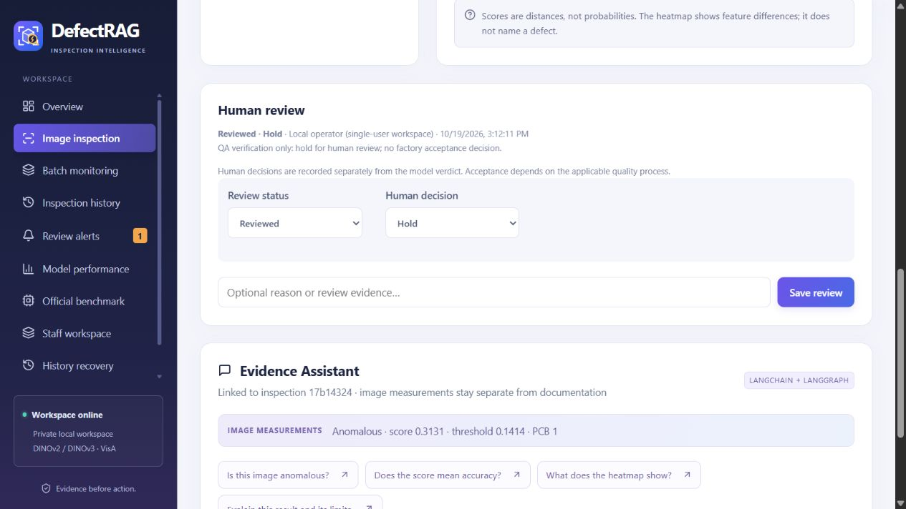

# Inspection workflow update — 19 October 2026

## Changes

- Late inspection/chat/message responses are discarded when their inspection or
  account context changes. Opening history synchronizes the product and batch.
- Sharing and staff changes refresh the main views. Visible workspaces refresh
  every15 seconds, with section-specific failure messages and manual retry.
- History offers filtered and all-record CSV downloads. A filter miss has a clear
  empty state and a clear-filters button.
- Reports use an allowlist of useful measurements. Signed artifact links and owner
  IDs are omitted from the visible table. Images remain privately authorized.
- Batch items checkpoint in IndexedDB, scoped to the current account in that
  browser. Retry submits only failed/pending items. Stable item IDs and content
  fingerprints allow the server to return an existing result after an interrupted
  response instead of repeating inference. Completed image files are removed from
  the browser resume copy; pending files remain for retry.
- Human review records Needs review / In review / Reviewed, a Pending / Hold /
  Accept / Reject decision, an optional note, reviewer and timestamp. The model
  verdict and measurements remain unchanged. Staff review links to the existing
  inspection/assistant page on the live Space.
- Invalid-image errors and cloud/local labels are clearer. Active DINOv2 and Qwen
  primary sources are listed. Layout, colors and CSS are preserved.

## Storage and permissions

No Supabase migration is required. Staff review events use the existing staff_notes
table as bounded `DEFECTRAG_REVIEW_V1:` JSON notes. The existing RLS enforces author
identity and active-record membership. Reviewer identity and time come from the
database row, not the embedded JSON. Previous plain notes remain readable. Review
events are append-only; earlier decisions remain in the report audit history.
Local review uses the existing SQLite audit_events table and identifies its actor
as a local operator, not an authenticated staff identity.

Browser batch recovery is local to the account and browser/device. It is not a
shared cloud job queue, and clearing browser data removes pending uploads. The most
recent batch per account is retained. Opening another device does not recover its
pending files. Supabase continues to hold successful staff inspections.
The direct app and the embedded Hugging Face app may use separate browser storage;
resume in the same app context, or select the unfinished files in the other context.

ZeroGPU quotas remain in effect. Staff Supabase sign-in is separate from Hugging
Face GPU allowance. No exact remaining GPU allowance is claimed. An acknowledgement
still means seen; the new human review decision is the separate auditable action.
Conversation model provenance is not cryptographically attested by this update.

## Update the existing GitHub repository from PowerShell

Run from the complete application folder after this source update has been synced:

```powershell
Set-Location 'C:\Users\User\Desktop\DefectRAG-v2'
.\deployment\Update-GitHub.ps1

$repo = Join-Path $PWD 'development-support\github-ready\DefectRAG'
git -C $repo diff --cached --stat
git -C $repo commit -m "Fix inspection context, add batch recovery and staff reviews"
git -C $repo push origin HEAD
```

For a different existing clone:

```powershell
.\deployment\Update-GitHub.ps1 -RepositoryPath 'C:\path\to\DefectRAG'
```

The script copies/stages exactly the21 paths in WORKFLOW_UPDATE_FILES.txt. It checks
the existing origin is WAYTECHG/DefectRAG, preserves conflicting local edits, and
never commits or pushes automatically. It also refuses an already staged change
set so unrelated work cannot be included accidentally. Inspect the staged changes
before the explicit commit/push commands. Do not force push.

No models, datasets, virtual environments, node_modules, runtime databases, private
test receipts, .env files or Supabase config.js are part of this update. Build
outputs are generated from source. GitHub and Hugging Face deployments are separate;
pushing this GitHub repository alone does not update the existing Space.

## Validation

The checkpoint in DEVELOPMENT_PROGRESS.md records final tests and hosted revision.
Regression coverage includes delayed cross-inspection answers and record loads,
quota interruption/resume, stable IDs, filtered exports, review validation/audit,
report escaping and preserved model measurements. Real inference verification is
reported separately from software fixtures. No model retraining is part of this update.


