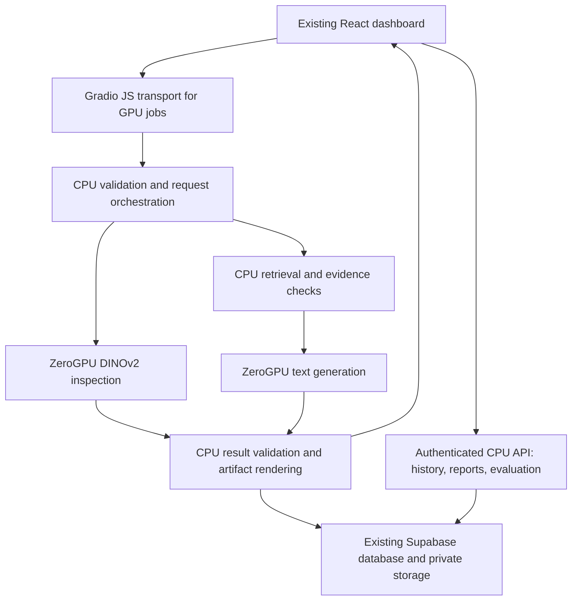

# ZeroGPU migration assessment — updated 18 October 2026

## Current implementation status — supersedes historical Phase 1 restrictions

The user authorized continuous Phases2–5. Phases2/3 now passed in the existing
Space at commit a31f52b64c91b7d6dab34113bc17a5bfac37ff72. The same React dashboard
is retained with byte-identical CSS, Gradio-client model calls and reused FastAPI
CPU routes. All12 existing DINOv2 banks passed24-image local/cloud parity checks;
no training, threshold changes or repeated accuracy experiments. Arbitrary valid
uploads are supported. See ZEROGPU_PHASE2_RESULTS.md and ZEROGPU_PHASE3_RESULTS.md.

Real in-Space Qwen3-4B-Instruct-2507 generation passed after moving existing CPU BGE
embedding into a bounded CPU-only child process within the same Space. This avoids
the observed parent/fork CUDA initialization interaction. Existing workflow evidence,
measurement, quote and citation guards remain. Measurement answers bypass generation;
failed generation is explicitly retrieval-only. Cloud does not depend on Ollama.
Python3.12.12/Torch2.8/Gradio6.30/spaces0.51.3/Transformers5.20.1/Hub1.31.0 are
verified in cloud; original local dependencies remain unchanged. Hub1.31 resolves
the historical preinstalled datasets warning below. Actual GPU: Blackwell MIG48GB.

Fresh per-job clients and SSR disabled resolved the observed session-lifecycle
errors in captured bounded tests; long-running concurrency/reconnect tests remain
unverified. Anonymous sessions/files are isolated and temporary; generic Gradio
private-file reads403. Browser inspection, live RAG, archive/recovery, report and
CSV passed. A two-image guest batch hit quota after one success; no full batch pass
is claimed. This is shared free GPU capacity, not guaranteed unlimited service.

Phase4 Supabase adapter reuses existing staff JWTs, RLS, tables and private bucket;
no service key. It is disabled in the deployed app. Latest user answer: SQL NOT
executed. User will execute the reviewed additive two-function migration manually;
the agent must not modify the database. Do not enable persistence or write-test it
until their explicit success confirmation. Authenticated staff and live nonstaff
denial tests, durable multi-user/restart acceptance and full Phase5 remain pending.
Staff-submitted answers lack model provenance attestation; acknowledgement lacks
actor/time audit. See ZEROGPU_PHASE4_READINESS.md and ZEROGPU_PHASE5_PARTIAL_RESULTS.md.

## Historical Phase 1 assessment and evidence

## Phase 1 decision and measured outcome

The user approved React + Gradio Server mode and Phase 1 testing only. That proof
now passed locally and on the existing empty `Wizzas/DefectRAG` ZeroGPU Space.
The original React dashboard/CSS was preserved, and the official JS client carried
one genuine DINOv2 inspection in each environment. Cloud execution reported
ZeroGPU=true and an RTX PRO 6000 Blackwell MIG 48 GB allocation. Score difference
for the same public PCB1 fixture was 0.0000825822, with the same Anomalous verdict.
This supports the recommended architecture for the tested path, not full migration
or all-category numerical certification. Detailed evidence, versions and saved
artifacts: [Phase 1 results](ZEROGPU_PHASE1_RESULTS.md).

Compatibility changes are isolated under deployment/zerogpu_phase1. The Gradio
6.30.0 / original Transformers 4.57.6 dependencies conflict over Hub (<1 versus
>=1.16). The proof uses Transformers 5.20.1/Hub 2.2.0 in its own environment;
production dependencies remain unchanged. HF's preflight rejects the +cu128 Torch
version suffix; supported torch==2.8.0 resolved that error. Cloud Python 3.12.12,
Gradio 6.30.0, spaces 0.51.3 and Torch 2.8.0 executed successfully. Its unused
preinstalled datasets package has a remaining Hub <2 dependency warning.

The cloud proof permits only the public PCB1 fixture, uses ephemeral isolated
history and publishes blank Supabase settings. No RAG/batch/cloud-staff migration,
Qwen model, private history, retraining or full application release occurred.
Original local app, models/results, Supabase configuration and static showcase
are preserved; Wizzas/defectrag-inference was not changed.

Cloud logs also expose post-result SSE errors when Gradio cannot find a stream's
queue session. Immediate condition is traced to routes.py's missing-session check;
the reconnect/cleanup trigger remains unconfirmed. This did not prevent delivery
of the genuine result, but requires bounded diagnosis before production readiness.

Outstanding gates: SSE session lifecycle, authenticated HF iframe quota identity, dual authentication,
restart/concurrency/quota tests, remaining-category parity, generation-provider
quality and durable authenticated backend persistence. Phase 1's direct hf.space
guest request does not prove these. **STOP after Phase 1; Phase 2 needs approval.**

## Original assessment — 17 October 2026 (historical)

Status: assessment complete; implementation awaits user approval. No application
code, UI assets, dependencies, model weights, thresholds, datasets or database
were changed during this review. No experiments or GPU jobs were run.

## Recommendation and confidence

Retain the existing React/Vite dashboard and serve its production build from one
Hugging Face **Gradio SDK** Space. Use **Gradio Server mode** as the application
host, reuse the existing FastAPI CPU services, and route GPU work through Gradio's
queued API and the official JavaScript client. Keep the same Supabase project
for authenticated staff collaboration and durable records.

This is architecturally feasible, not a deployment certification. Gradio documents
custom React frontends, Server-mode FastAPI routes, queues and ZeroGPU support.
Its guide requires the JavaScript client for browser ZeroGPU calls so iframe
authentication reaches quota handling. The integration must pass a small actual
Space test before the rest of the migration. [Server-mode guide](https://gradio.app/guides/server-mode),
[Server API](https://gradio.app/docs/gradio/server).

Gradio 6.30.0 is a published candidate as checked today, not a dependency installed
in this project. Pin the eventual validated SDK rather than relying on latest.
[Published release](https://pypi.org/project/gradio/6.30.0/).

## Current application findings

Reviewed the source mirror at commit 67b2378 and the Desktop installation at the
same Git commit. Desktop has existing user edits to deployment/RUN_AND_DEPLOY.md
and frontend/public/config.js; preserve both. Public settings in public/config.js
and dist/config.js contain a non-placeholder Supabase URL and publishable key.
Values were not printed or copied into this assessment. No live Supabase schema,
RLS, account access or data was inspected. Earlier notes saying Supabase was
unconfigured are historical and do not describe the current public settings.

| Existing area | Finding and migration consequence |
|---|---|
| React UI | main.jsx, InspectionViewer.jsx, BenchmarkReport.jsx, ArchiveDialog.jsx, TeamWorkspace.jsx and both CSS files provide the existing interface. Keep their visual design and interactions. |
| Transport | main.jsx has one fetch-based api() helper; inspection and batch use FormData. Change the transport layer, retaining the result/error contracts used by the UI. |
| Hosting | backend/main.py already serves frontend/dist. Its final root StaticFiles mount must not swallow Gradio queue, upload or API routes. Hash-based React navigation simplifies preserving routes. |
| Vision | highres.py is the active DINOv2 448-short-edge profile; vision.py is the preserved DINOv3 fallback. Both lazily initialize GPU resources and use detector objects with locks and cached GPU tensors. |
| RAG | rag.py uses CPU BGE embeddings, local vectors, LangGraph, saved-measurement answers and source/quote validation. Only its generation step calls localhost Ollama. The LLM receives saved facts and text, not the inspected photograph. |
| Local persistence | create_app hardcodes SQLiteRepository and local artifact files. These are single-workspace, lack per-user API ownership checks, and are unsuitable as shared public history. |
| Supabase | cloud.js manually uploads a result snapshot and images; TeamWorkspace reads shared_inspections, staff_members, notes and archive/restore RPCs. This is separate from the backend's SQLite history. |
| Static showcase | frontend/dist-static and showcase.js remain a separate saved-example mode. Preserve them and their historical model IDs. They do not provide live AI. |

## Architectural options

| Option | UI fidelity | One ZeroGPU Space? | Decision |
|---|---|---|---|
| React served by gradio.Server, GPU calls through @gradio/client | Existing React HTML/CSS/components remain the visible app | Documented architecture; validate this application | **Recommended** |
| Existing FastAPI host with a mounted, non-primary Gradio Blocks API | Same React can remain at the root | Gradio mounting exists; exact Space startup, routing and quota behavior need verification | Fallback if Server-mode integration fails; additional routing/lifecycle plumbing |
| React embedded inside a Gradio iframe wrapper | Inner design survives, but viewport, focus, downloads and auth gain another frame | Possible candidate, not tested here | Avoid when Server mode can serve React directly |
| Docker or Static SDK with the existing app unchanged | High fidelity | Does not satisfy Gradio-only ZeroGPU scheduling | Reject for this requirement |
| Rebuild the dashboard using standard Gradio widgets | Changes the existing interface | Can use ZeroGPU | Reject: violates the UI requirement |

Mounting Gradio into FastAPI is an official mechanism, not proof that an unchanged
Uvicorn launch gives correct ZeroGPU identity forwarding.
[Mounting API](https://gradio.app/docs/gradio/mount_gradio_app).

## Proposed request and storage boundaries

This remains one application URL and one Space. Supabase is the existing external
data service; a second web host, local computer or Ollama server is not required.

Retain /api endpoints for CPU operations where useful. Replace direct fetch GPU
submissions with a small client adapter using @gradio/client; preserve response
shapes for the current components. Expose queue/cancel/quota states through the
existing status/error areas, without changing layout, navigation or visual style.
Correct text such as "images stay on this device" for the hosted runtime.

Serve index.html and static assets with explicit routes/prefixes after confirming
Gradio route registration order. Do not blindly retain a root catch-all mount or
embed the whole app in gr.HTML. Build React outside the Space and include its
approved dist output, avoiding a second Node production server.

## Vision and ZeroGPU constraints

Both detectors use ordinary PyTorch/Transformers inference and saved banks. There
is no apparent algorithmic need to retrain. DINOv2 remains the default; DINOv3 is
optional, subject to its existing checkpoint access and redistribution terms.
Do not publish gated weights blindly or replace assets with a different revision.

Current ZeroGPU documentation requires the Gradio SDK, scheduled @spaces.GPU
functions and bounded durations. It supports PyTorch 2.8.0 among its listed
versions and Python 3.12.12. Models should be registered at module scope under
the SDK's CUDA emulation, with real inference inside scheduled functions.
There are daily quotas and queues; no uninterrupted GPU or latency guarantee.
The current default large allocation is listed as 48 GB; verify actual allocation
and account eligibility in the first test. [ZeroGPU documentation](https://huggingface.co/docs/hub/spaces-zerogpu).

Specific adaptations from inspected code:

- Import spaces before GPU initialization. Use a Space-specific eager runtime;
  keep lazy loading and current behavior for the working local installation.
- Prepare/checksum immutable encoders and banks at startup. Normalize banks on
  CPU before registering their tensors; current GPU F.normalize in load() must
  not become an eager startup CUDA kernel.
- The worker boundary accepts image arrays/bytes and category identifiers and
  returns ordinary values and CPU arrays. Do not pass Detector locks, repositories
  or CUDA tensors between processes. Treat warm caches as optional optimizations.
- Keep authorization, persistence, report generation and artifact commits outside
  the worker. Do not rely on worker mutations updating a parent SQLite database
  or Python object. Invoke scheduled work within the Gradio request context.
- Use explicit queue concurrency across GPU endpoints. Existing threading.Lock
  is not a cross-process scheduler. Bound batch jobs and support partial progress;
  a current 20-image synchronous batch must not become an unbounded lease.
- Measure one representative job before choosing duration. Reject oversized image
  geometry and prompts before scheduling; pixel-count limits alone do not bound
  the high-resolution encoder's aspect-preserving token grid.

The process boundary and immutable-resource guidance are described in the
[official lifecycle reference](https://github.com/huggingface/skills/blob/main/skills/huggingface-zerogpu/references/how-zerogpu-works.md)
and [concurrency reference](https://github.com/huggingface/skills/blob/main/skills/huggingface-zerogpu/references/concurrency.md).
Do not copy the Windows .venv or its cu126 installation into a Linux Space; resolve
the supported Linux CUDA build and matching torchvision without unnecessary upgrades.

Preserve encoder SHA256, preprocessing, bank contents, threshold and review-band
logic. Confirm numerical parity on existing saved checks across categories, not a
fresh benchmark run. Existing AUROC reports remain historical local measurements;
they do not establish cloud latency or guarantee identical floating-point scores.

## Live evidence assistant without Ollama

Keep BGE embeddings and vector retrieval on CPU, the LangGraph workflow, trusted
measurement-only answers, model-family filtering, quote IDs and answer validation.
Replace generate()'s Ollama HTTP call with an injected generation provider.

Recommended cloud candidate: **Qwen/Qwen3-4B-Instruct-2507 through Transformers in
the same Space**, using a separate bounded ZeroGPU job. Its official card lists
Apache-2.0 licensing and a non-thinking instruction model. Four billion parameters
at two bytes each imply roughly 8 GB of raw weights; startup RAM, disk, activations
and actual VRAM still need measurement. It is a proposed new generation provider,
not a model downloaded or quality-tested for this app. [Model card](https://huggingface.co/Qwen/Qwen3-4B-Instruct-2507).

Retaining Qwen2.5-3B is technically another option, but its official HF model card
lists qwen-research licensing; verify intended public-use terms rather than
assuming Apache-2.0. [Existing-family model card](https://huggingface.co/Qwen/Qwen2.5-3B-Instruct).

Cap retrieved passages, recent conversation and output tokens; validate generated
JSON with the existing schema. Transformers generation does not automatically
reproduce Ollama's schema-constrained decoding. Keep deterministic saved-fact
answers and retrieved-source fallback when generation is invalid or quota is
unavailable. Never label fallback excerpts as generated answers. Reuse the five
existing assistant acceptance cases before approving the provider.

An external inference provider can reduce shared GPU contention but introduces
separate model availability, credentials and billing. Its free allowance is not
an unlimited service guarantee, so it is an optional alternative, not the default.
[Provider billing](https://huggingface.co/docs/inference-providers/pricing).
CPU-only generation avoids GPU quota but needs a measured latency/quality check
and is not proposed as the main public experience.

## Reuse the existing Supabase project

Reuse the configured project URL, Auth users, staff allowlist, shared inspections,
review notes, archive/restore functions and private team-inspections bucket. Do
not provision a second project or rerun the original schema against live custom
policies blindly. First inspect the actual schema and take an appropriate backup;
then use additive, versioned migrations only.

Add a cloud repository behind the existing repository boundary for authoritative
inspection runs, linked messages, alerts and artifacts. The current shared snapshot
tables do not implement the backend's complete history model. Keep explicit staff
sharing; do not silently upload old private local history or expose all records.
Any one-time historical import is separately approved and idempotent.

Public visitors may browse saved examples and receive isolated temporary live
results. Durable private history and collaboration require Supabase sign-in.
Guest artifacts have bounded retention and can disappear on restart. Staff runs
are saved to Supabase rather than relying on the Space disk.

Validate the Supabase access JWT and ownership in every relevant API and Gradio
entry point, including image/heatmap downloads, reports, CSV, chat, restore and
job polling. Hugging Face identity controls GPU quota; Supabase identity controls
records. Signing into one does not automatically sign into the other.
Do not overwrite HF quota headers with a Supabase token. Confirm both identity
channels in the first integration test; credentials must not enter job outputs.

Use user-scoped access/RLS for reads and a carefully authorized server write path
for immutable model measurements. Existing browser snapshot insertion must not
be treated as proof a server ran inference. Service-role credentials, if needed
for restricted server operations, stay only in Space Secrets and bypass RLS, so
the server must enforce ownership itself. Never put them in config.js or React.
[Supabase JWTs](https://supabase.com/docs/guides/auth/jwts),
[Storage access control](https://supabase.com/docs/guides/storage/security/access-control).

Update Auth redirect allowlists for the final .hf.space origin. Test login/reset,
private signed URLs and browser storage in both the HF page iframe and direct app
URL. Retain passwords and user membership; no new staff accounts are implied.

Space local storage is ephemeral. Use Supabase for durable records and private
artifacts; bundle only reproducible application/model assets. Do not depend on a
free persistent local SQLite volume. [Space storage](https://huggingface.co/docs/hub/spaces-storage).

## Incremental file/dependency plan — proposed, not implemented

| Files | Proposed change |
|---|---|
| New app.py / Space entry module | Gradio Server host, scheduled endpoints, eager model registry and explicit React asset routes |
| backend/main.py | Inject app/repository/services; separate computation from persistence; reuse CPU routes with authentication |
| backend/highres.py, backend/vision.py | Reuse math and assets; add a separate Space runtime adapter rather than break local loading |
| backend/rag.py, backend/config.py | Injectable text-generation provider, hosted settings, bounded generation; preserve validation |
| backend/storage.py + new cloud repository/auth module | Supabase-backed ownership-aware history/messages/alerts and private artifact access |
| frontend/src/main.jsx + new transport adapter | Gradio client for GPU jobs and authenticated CPU calls; maintain current component/result contracts |
| frontend/src/cloud.js, TeamWorkspace.jsx | Reuse staff UI/client, coordinate authentication and authoritative persisted records; no redesign |
| deployment/supabase.sql + new versioned migration | Use existing schema as reference; add needed cloud persistence and policies without destructive reset |
| frontend/package.json / lockfile | Add only @gradio/client for the cloud transport; existing React/Supabase packages remain |
| Separate deployment requirements / Space README | Validated gradio, spaces, supported torch/CUDA and Python; optional auth client only if needed |
| frontend/dist | Rebuild from preserved source after approved transport changes; serve the resulting assets |
| tests / deployment checks | Add scoped queue, identity, ownership, persistence, generation and numerical-parity checks |

Leave style.css, theme.css, logo, visual components, local Windows launcher,
models/results and frontend/dist-static intact unless a specific nonvisual
integration adjustment is needed. Do not install vLLM, Ollama, training packages,
quantization libraries or custom CUDA extensions merely for this migration.

Deploy from an allowlist. Exclude .venv, .python-deps, node_modules, experiment
caches, private runtime history, local .env files, legacy-projects and research
backups. Supply only the active model/card/banks, approved documents/evaluation
reports, code and compiled React assets. Keep file-serving allowlists narrow;
Gradio upload/output caches must not expose another visitor's inspection.

## Milestones and decision gates

| Phase | Deliverable and exit condition |
|---|---|
| 0 — this review | Source inspection, official documentation, recommended architecture and progress note. Complete. Stop for approval. |
| 1 — minimal compatibility test | Isolated deployment profile; unchanged React build at root; one scheduled existing-model request via JS client; verify real hardware, HF quota context, routes and Supabase identity transport. No full migration if this fails. |
| 2 — vision adapter | Preserve fixed assets; compare saved examples across all 12 categories, bound image geometry/batches and test queue/quota errors. No model fitting or test-set tuning. |
| 3 — generation adapter | One proposed Qwen provider, existing retrieval/validation, five saved acceptance cases and explicit fallback. Measure bounded duration and memory. |
| 4 — durable collaboration | Reuse live project with approved additive migration; two-user ownership tests, artifacts/messages/reports/CSV/archive/recovery and optional historical import. |
| 5 — release verification | All current pages/animations/charts/viewers retained; desktop/mobile browser checks, iframe/direct-origin auth, restart persistence, cancellation/failure paths and deployment allowlist review. |

An accessible Space can still sleep, queue or exhaust quota. Unlimited anonymous
inspection, always-on GPU service, large continuous batches and guaranteed LLM
availability cannot be promised for free. Durable anonymous history needs an
additional identity/persistence design; unrestricted live factory throughput
would require different hosting or paid resources. Automated background GPU jobs
and training are not part of this migration.

## Precise next steps after approval

1. Confirm target Space repository/access and actual ZeroGPU hardware eligibility;
   these were not inspected. Use existing Supabase public settings securely; obtain
   authorized backend configuration through Secrets, not pasted private keys.
2. Create only the isolated Phase 1 compatibility profile and minimum dependency
   lock. Do not change the default local launch or publish private assets.
3. Demonstrate the same React shell plus one real queued inference, correct quota
   identity and route behavior. Stop and report measured results before expanding.
4. Continue later phases only while preserving the working app/showcase and the
   user's UI requirement. Gate any changed model provider on its acceptance check.

No cloud compatibility, generation quality, deployed latency, live RLS behavior or
restart durability was verified in this assessment. Existing local test results
are preserved and are not claimed as cloud acceptance results.
